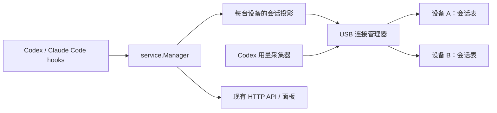

> 当前协议为 2：设备只接收本机 AgentMate 汇总后的投影；SESSION 包含 host_label 和 session_short_name，标题为主机短名*Session短名。跨节点订阅、启停及持久化由电脑服务处理。旧配对章节仍属未来规划。

# AgentMate 服务端与 ESP32 通信技术方案

> **一期实现更新（2026-10-01）**：当前固件首次烧录进入产测模式，产测完成后经 `AT+MODE=NORMAL` 进入正常模式。正常模式经 `AT+HELLO=2,<nonce>` 发现后直接接收业务命令；配对、四位码和 HMAC 认证调整为二期规划。本文旧版配对/认证流程章节仅保留为二期设计参考；一期线格式及命令可用性以 [AT 指令指南](agentmate_at_command_guide.md) 为准。当前原型的 AT 通道为 CH340 桥接的 UART0（115200 8N1）；运行期和 bootloader 常规日志关闭，应用日志仅使用可开关的 `+LOG:` 行，ROM 复位字节在发现前丢弃。


状态：ESP32 基础版固件已实现；服务端对接待完成  
方案版本：**V0.3，2026-10-01**  
范围：设备发现、识别、活动检测、多设备、会话与 provider 用量同步；不定义屏幕和灯环如何显示。

## 1. 方案选择

首版使用 **USB 串口 + AgentMate 专用 AT 风格指令**。电脑上的 AgentMate 服务端主动枚举串口、握手并发送命令；ESP32 被动响应。[产品 PRD](agentmate_prd.md) 已将 USB 串口和 AT 指令列为首版方案。ESP32 工程的基础版固件已接入 USB AT 与英文显示；服务端串口对接仍需完成。

设备维护一个**固定容量的会话表**。首次连接时，服务端逐条同步应显示的会话；运行中哪个会话变化，就只更新或删除该会话。Codex 账号用量通过独立指令同步。ESP32 无需解析 JSON，也无需缓存服务端完整 `Status` 对象。服务端负责选择设备容量内的会话并处理超额情况。



## 2. 现有数据与边界

- 服务端 `internal/service.Manager` 已维护会话状态；`internal/model.Session` 包含 provider、session ID、状态、最近任务结果与可选的 `ContextUsage`。`internal/codexusage.Collector` 提供单独的 Codex 配额快照。设备协议不改变当前本机 HTTP 和 Unix socket 接口。
- 会话状态沿用服务端已有的 `initializing`、`ready`、`working`、`waiting_for_input`、`permission_required`、`stale`、`ended`、`offline`。设备连接的 `offline` 与 Agent 会话的 `offline` 分开处理。
- `working` 五分钟无活动变成 `stale` 属于 Agent 会话规则，不能据此判断设备掉线。
- 首版设备不接收原始工作目录、session ID、PID、hook payload、完整任务内容或账号信息。服务端为投影中的会话分配短 `session_key`，其在一次服务端启动期间稳定。`server_epoch` 改变后，旧 key 全部失效。
- Claude 与 Codex 的 `context_usage` 均通过会话指令发送。已知时填四个数字，未知时填四个 `?`；Codex 四字段全空保留为不支持语义。协议保持 2，服务端与固件同步升级。

## 3. 二期规划：设备身份识别与配对

1. 服务端启动时枚举串口，之后监听系统插拔事件；无法得到事件的平台每 3 秒扫描。VID/PID、产品名、接口类型和用户指定端口只用于筛选候选端口，不能单凭这些属性认定为 AgentMate。
2. 以 `115200 8N1` 打开候选端口，等待设备启动稳定，发送 `AT+HELLO`。只有协议标识为 `agentmate`、主版本兼容、nonce 回显正确、`device_id` 与设备容量字段合法的回应，才算协议兼容。探测超时 2 秒即关闭端口并退避，避免长期占用其他串口设备。
3. `device_id` 是固件首次启动时生成并存入 NVS 的随机 128 位值，不依赖串口路径。服务端的 `server_id` 也应在本机安装期间持久不变，不能用每次启动变化的 `epoch` 代替。设备只保存一台电脑的 `server_id` 与 256 位随机长期密钥。设备仅在 `HELLO` 的 `server_id` 与已保存记录相同时返回 HMAC proof；未配对或来自另一台电脑时返回 `-`，供服务端识别为“未与本机配对”，但此时尚未证明设备身份。
4. 本机服务端对未知配对设备自动发起一次 `PAIRBEGIN`；设备在 120 秒窗口内显示四位码和设备 ID 后八位，串口只返回 `pair_id` 与剩余秒数。用户在现有本机网页面板的对应设备卡片输入四位码。服务端预先保存待确认的随机密钥，再以 `PAIRCOMMIT` 发送 `pair_id`、四位码和密钥。设备最多允许三次错误输入；成功后原子替换旧配对，服务端重新 `HELLO` / `AUTH` 确认。若旧配对存在而新配对超时、失败或 NVS 写入失败，旧配对继续有效。窗口过期不自动反复弹出，网页可在冷却结束后重新请求。
5. 协议兼容但未认证的设备不接收状态。已知配对密钥认证失败时报告异常，由用户从网页手动重新配对；正常探测不从设备读取密钥。同一 `device_id` 同时出现于两个端口时只保留一条连接并报告冲突。开发阶段的未配对调试模式必须显式启用并标明身份未验证。

设备连接状态建议为 `discovered → probing → pairing/unpaired/paired → online → degraded/offline`。四位码是人在设备前确认配对的短时凭证，不直接充当后续 HMAC 密钥；首次长期密钥仅经本机 USB 串口传输。设备断电重连、服务端重启后直接用持久密钥认证，不再显示四位码。

## 4. AT 行格式

串口使用 ASCII，每行以 `\r\n` 结束，接收端兼容单独 `\n`。单行最多 **256 字节**（含行尾）；固件使用固定大小行缓冲区，超长行丢弃到下一个换行符并返回错误。首版参数仅包括十六进制 ID、非负十进制整数、固定枚举值、限定字符集 `[A-Za-z0-9_.-]` 的短标识，以及明确允许的空字段或 `?`。不接受空格、引号或任意转义文本。以后若需要任意文本，应新增长度明确的命令，不直接塞进逗号分隔字段。

服务端任一时刻只发送一条尚未完成的命令；设备可先返回 `+...:` 数据行，最后必须返回单独的 `OK` 或 `ERROR`。错误时在 `ERROR` 前可返回 `+ERR:<code>`。服务端收到最终结果再发送下一命令。设备调试日志不能混入协议串口。未知命令回复 `+ERR:UNKNOWN_COMMAND`、`ERROR`，不能重启。

```text
AT+PING=74a8
+PONG:74a8,123456
OK
```

`device_id`、`server_id`、`server_epoch`、`pair_id` 和握手 nonce 均为 32 个小写十六进制字符；`event_id` 也为 32 个小写十六进制字符。四位 `pin` 是字符串，可有前导零；长期密钥是 64 位小写十六进制字符。`session_key` 是由服务端分配的 1～8 位小写字母或数字，不能使用原始 session ID。协议主版本首版为 `1`，本次增加的配对命令见 [AT 指令指南 1.2](agentmate_at_command_guide.md)。固件逐项检查参数个数、字符集、数值范围及当前连接阶段。

## 5. 指令清单

| 命令/响应 | 方向 | 用途 |
|---|---|---|
| `AT+HELLO=<protocol_version>,<server_nonce>,<server_id>` | 服务端 → 设备 | 探测、版本协商与身份挑战 |
| `+HELLO:<protocol_version>,agentmate,<server_nonce>,<device_id>,<device_nonce>,<model>,<software_version>,<max_sessions>,<max_usage_entries>,<proof>` | 设备 → 服务端 | 回显 nonce，报告身份和容量；后接 `OK` |
| `AT+PAIRBEGIN` / `+PAIR:<pair_id>,<remaining_s>` | 服务端 / 设备 | 开启或查询当前四位码窗口；后接 `OK`，不传 pin |
| `AT+PAIRCOMMIT=<pair_id>,<pin>,<key_hex>` | 服务端 → 设备 | 校验屏幕四位码并保存新配对；成功后 `OK` |
| `AT+AUTH=<host_proof>` | 服务端 → 设备 | 服务端证明持有配对密钥；成功后 `OK` |
| `AT+SYNCBEGIN=<epoch>,<sync_id>` | 服务端 → 设备 | 开始一次全量会话核对，标记旧条目为“尚未看到” |
| `AT+SESSION=<epoch>,<key>,<rev>,<provider>,<state>,<last_task>,<finished_at>,<task_seconds>,<ctx_used>,<ctx_window>,<ctx_pct_bp>,<ctx_updated_at>` | 服务端 → 设备 | 新增或更新**一条**会话；成功后 `OK` |
| `AT+DELETE=<epoch>,<key>` | 服务端 → 设备 | 删除一条会话；不存在也返回 `OK` |
| `AT+SYNCEND=<epoch>,<sync_id>` | 服务端 → 设备 | 删除本轮未出现的旧条目，结束全量核对 |
| `AT+LIST?` / `+LIST:<epoch>,<count>,<max_sessions>`、多条 `+ITEM:<key>,<rev>` | 服务端 / 设备 | 查询设备当前会话清单；最后返回 `OK` |
| `AT+GET=<key>` / `+SESSION:...` | 服务端 / 设备 | 查询设备当前一条会话的完整协议字段；最后返回 `OK` |
| `AT+USAGE=<epoch>,<provider>,<metric_key>,<window_key>,<used_bp>,<reset_at>,<window_seconds>,<updated_at>` | 服务端 → 设备 | 同步一条 provider 用量窗口 |
| `AT+USAGECLEAR=<epoch>,<provider>` | 服务端 → 设备 | 清除指定 provider 的用量记录 |
| `AT+EVENT=<epoch>,<event_id>,<key>,<provider>,<kind>,<occurred_at>` | 服务端 → 设备 | 即时任务提醒，按 `event_id` 去重 |
| `AT+PING=<nonce>` / `+PONG:<nonce>,<uptime_ms>` | 服务端 / 设备 | 心跳；回应后还有 `OK` |
| `AT+TIME=<unix_ms>` / `+TIME:<device_unix_ms>,<uptime_ms>` | 服务端 / 设备 | 按服务端 UTC 时间校准设备时钟 |
| `AT+TIME?` / `+TIME:<device_unix_ms>,<uptime_ms>,<sync_age_ms>` | 服务端 / 设备 | 查询设备当前时间和最近校时状态 |
| `AT+INFO?` / `+INFO:<device_id>,<model>,<software_version>,<protocol_version>,<max_sessions>` | 服务端 / 设备 | 只读诊断；回应后 `OK` |
| `AT+TFTBRIGHT=<value>` / `AT+TFTBRIGHT?` | 服务端 / 设备 | 设置或查询 TFT 背光亮度，设置值保存到 NVS |
| `AT+LEDBRIGHT=<value>` / `AT+LEDBRIGHT?` | 服务端 / 设备 | 设置或查询 LED 灯环亮度，设置值保存到 NVS |
| `AT+TFTROTATE=<angle>` / `AT+TFTROTATE?` | 服务端 / 设备 | 设置或查询 0/90/180/270 度界面旋转，设置值保存到 NVS |
| `+ERR:<code>` / `ERROR` | 设备 → 服务端 | 参数、状态或容量错误 |

`max_sessions` 是设备**实际支持的总会话槽数**，首版建议在 1～16 范围内由固件按可用内存确定并在握手及 `LIST?` 中报告。服务端不能假定每台设备都支持相同数量。`max_usage_entries` 是可保存的 provider 用量窗口记录数；不支持此功能时可报 `0`。新固件若调整容量，下次连接重新读取。

设备支持 `LIST?` 和 `GET`，既方便串口终端调试，也供服务端校对当前状态。`GET` 查询不存在的 key 返回 `+ERR:NOT_FOUND`、`ERROR`。`SESSION` 若容量已满且 key 不存在，返回 `+ERR:CAPACITY`、`ERROR`；服务端先删除不再入选的旧 key，再添加新 key。

### 5.1 二期规划：握手与认证

```text
AT+HELLO=2,fe6d7e13d354eb1f8d45968587589c65,1337a242cd1845299b397e8222293984
+HELLO:1,agentmate,fe6d7e13d354eb1f8d45968587589c65,8d2b47e0a99347c7a976d386dc194fa2,d8c4b78b9c63195dd337cbcb3f88b914,agentmate_esp32c3,v1.0,4,8,<proof>
OK
AT+AUTH=<host_proof>
OK
```

真实传输中 `<proof>`、`<host_proof>` 分别是 64 个小写十六进制字符；未与当前 `server_id` 配对时 `<proof>` 为 `-`。`proof = HMAC-SHA256(device_key, "agentmate-v1/device/" || server_nonce || device_nonce || device_id)`；`host_proof = HMAC-SHA256(device_key, "agentmate-v1/host/" || server_nonce || device_nonce || server_id)`。拼接项均为 ASCII 原文且长度固定。服务端以常量时间比较 proof；设备验证 host_proof 后才接受同步指令。每次握手生成新 nonce，密钥和四位码不得出现在普通日志中。

首次配对示例（四位码仅显示在设备屏幕；`key_hex` 为占位符，实际传输需替换成 64 位十六进制密钥）：

```text
AT+HELLO=2,fe6d7e13d354eb1f8d45968587589c65,1337a242cd1845299b397e8222293984
+HELLO:1,agentmate,fe6d7e13d354eb1f8d45968587589c65,8d2b47e0a99347c7a976d386dc194fa2,d8c4b78b9c63195dd337cbcb3f88b914,agentmate_esp32c3,v1.0,4,8,-
OK
AT+PAIRBEGIN
+PAIR:6ac9d42b7b984ce7a33a328f0df13b51,120
OK
AT+PAIRCOMMIT=6ac9d42b7b984ce7a33a328f0df13b51,0042,<key_hex>
OK
```

之后重新 `HELLO` / `AUTH` 验证新密钥，才进行 `TIME` 与状态同步。设备在同一窗口重复收到 `PAIRBEGIN` 时返回相同 `pair_id`，不更换屏幕数字；错误三次关闭窗口并冷却五分钟。若提交响应丢失，服务端优先用待确认密钥重握手，避免要求用户无谓地重新输入。

### 5.2 单条会话格式

```text
AT+SESSION=629d8a7097154fb0a3e5d74ea00665c1,s1,7,claude,working,-,0,42,12000,200000,600,1790769600
OK
AT+SESSION=629d8a7097154fb0a3e5d74ea00665c1,s2,3,codex,permission_required,-,0,15,,,,
OK
```

`rev` 是当前 epoch 内该会话的递增 64 位版本。相同 `(epoch,key,rev)` 的重试只回复 `OK`，不重复触发变化，也不重置设备上的任务计时基准；较小版本被拒绝。`last_task` 是 `completed`、`failed`、`cancelled` 或 `-`，`finished_at` 是 Unix 秒，没有任务结果时为 `0`。`task_seconds` 是当次任务到本命令生成时已经持续的秒数，取值 `0–4294967295`。没有当次任务时为 `0`。进行中的 `working`、`waiting_for_input`、`permission_required` 填从该次任务开始累计的秒数，设备再用单调时钟继续累加，因此时长流逝本身不单独触发 `SESSION`。`stale` 填进入该状态前的累计秒数，设备不再累加。任务已结束时填该次任务的总秒数，并保持到下一次任务替换它。服务端若要校正时长，必须递增 `rev`。会话 `state` 使用服务端已有枚举。会话进程退出时，设备投影直接执行 `DELETE`；现有服务端可以继续保留 `ended` 历史记录，这与设备显示集合独立。

会话 context 的 `ctx_used`、`ctx_window` 为 token 数，`ctx_pct_bp` 为百分数的基点数（例如 `600` = 6.00%），`ctx_updated_at` 为 Unix 秒。Claude 与 Codex 暂时读不到 context 时，四字段为 `?,?,?,?`；Codex 四字段全空表示不支持上下文。解析器保留连续逗号产生的空字段，并拒绝混合空值、未知和数字。

### 5.3 首次同步、变化同步、删除与查询

首次连接或服务端重启后，执行以下流程：

1. 完成 `HELLO` / `AUTH`，读出 `max_sessions` 和 `max_usage_entries`。
2. 服务端根据当前 `service.Manager.Snapshot()` 选出最多 `max_sessions` 条会话。首版不选 `ended`；其余按 `permission_required`、`waiting_for_input`、`working`、`stale`、`ready`、`initializing`、`offline` 的优先级，再以服务端稳定键排序。
3. 先用 `LIST?` 查询设备旧 key；如果 epoch 未变且旧表已占满容量，先 `DELETE` 本次不再入选的 key，为新会话腾出槽位。随后发送 `SYNCBEGIN`，逐条发送 `SESSION`，最后发送 `SYNCEND`。新 epoch 的 BEGIN 会直接清空旧 epoch 的会话与用量；同一 epoch 的 BEGIN 只把已有条目标记为“尚未看到”。每条 SESSION 写入或更新并标记为“已看到”；END 删除仍未看到的条目。中途失败不执行 END，服务端重连后重新完整同步。这个办法只需一个固定会话表和每条一位标记，不要求设备保存两份完整快照。
4. 再发送 `LIST?` 校验设备的 epoch、key 与 rev 集合；有差异时用 `DELETE` / `SESSION` 修正。需要诊断某条具体内容时再用 `GET`。
5. 独立同步 provider 用量（当前先接入 Codex），随后进入增量运行状态。

例子（省略每条命令后的 `OK`）：

```text
AT+SYNCBEGIN=629d8a7097154fb0a3e5d74ea00665c1,1
AT+SESSION=629d8a7097154fb0a3e5d74ea00665c1,s1,7,claude,working,-,0,42,12000,200000,600,1790769600
AT+SESSION=629d8a7097154fb0a3e5d74ea00665c1,s2,3,codex,permission_required,-,0,15,,,,
AT+SYNCEND=629d8a7097154fb0a3e5d74ea00665c1,1
AT+LIST?
+LIST:629d8a7097154fb0a3e5d74ea00665c1,2,4
+ITEM:s1,7
+ITEM:s2,3
OK
```

运行中，服务端维护每台设备**期望出现的 key 集合**。某条已入选会话状态、任务结果或会话 context 变化时，仅发送它的 `SESSION`，并填入当时的 `task_seconds`。任务时长的自然增长不单独重发。新会话进入容量前 N 名时，先 `DELETE` 被挤出的会话，再发送新会话；入选会话进程退出或不再应显示时发送 `DELETE`。无变化时不重发所有会话。服务端每 60 秒可用 `LIST?` 校对 key/rev，发现缺失、额外或版本不一致时只修复差异；设备 epoch 不一致时重新执行完整同步。`GET` 用来核对单条详情或人工诊断，不承担频繁轮询。

`DELETE` 对不存在的 key 幂等。`SYNCBEGIN` 与 `SYNCEND` 使用同一 `sync_id`；重复 END 幂等。同步中设备可立即更新已收到的单条会话，但只在成功 END 时清理旧条目。连接断开超过保活期限时设备清除远端会话及用量；再次连接从完整同步恢复。

### 5.4 独立的 provider 用量命令

```text
AT+USAGECLEAR=629d8a7097154fb0a3e5d74ea00665c1,codex
OK
AT+USAGE=629d8a7097154fb0a3e5d74ea00665c1,codex,l1,primary,4200,1790773200,18000,1790769600
OK
AT+USAGE=629d8a7097154fb0a3e5d74ea00665c1,codex,l1,secondary,1800,1790859600,604800,1790769600
OK
```

用量同步使用 provider 通用记录，不绑定 Codex 专属字段。`provider` 为 `codex`、`claude` 等来源标识；`metric_key` 标识某项指标或限额，`window_key` 标识其时间窗口，例如 `primary` / `secondary`。`used_bp` 是已用比例的基点数（`4200` = 42.00%），`reset_at` 为 Unix 秒，`window_seconds` 为窗口长度，`updated_at` 为采集时间。缺失窗口使用 `used_bp=-`、其余时间字段为 `0`。`max_usage_entries` 限制所有 provider 合计可存储的记录数。首次连接和某 provider 的用量集合变化时，对该 provider 执行 `USAGECLEAR` 后逐条发送其当前记录；采集失败时只清除该 provider 的记录，避免保留过期值。当前可先把 `codexusage.Snapshot` 转换为通用记录；其他 provider 有可用用量来源后复用同一命令。Session context 与 provider 用量记录相互独立。

### 5.5 即时事件

```text
AT+EVENT=629d8a7097154fb0a3e5d74ea00665c1,9c7775eaf6254acaa9ef9473510c3da2,s2,codex,permission_required,1790769600
OK
```

`kind` 首版为 `permission_required`、`completed`、`failed`、`cancelled`。设备缓存最近至少 32 个 event ID；重复命令仍回复 `OK`，但只处理一次。重连不重放历史提醒。即时事件用于一次性提醒，权威的当前状态仍来自单条 `SESSION` / `DELETE`。服务端不能从一般 `working` 推断“思考、编辑、测试”等更细状态。

## 6. 保活、超时与恢复

完成认证和首次同步后，每 10 秒发送 `AT+PING`，设备回显 nonce。心跳命令 5 秒超时；连续 3 次失败或串口读写失败，服务端将设备标记 `offline`、关闭连接并重新发现。设备若连续 30 秒没有收到有效命令，清除旧的远端会话与用量并进入“服务不可用”的通信状态；本方案不规定怎样显示。会话 `stale` 不影响设备心跳。

设备系统时间以服务端 UTC 为准。认证后服务端立即发送 `AT+TIME=<unix_ms>`，之后每 30 分钟校准一次；设备响应实际应用的 Unix 毫秒时间和单调 uptime。服务端用命令往返中点估算偏差，超过 100 毫秒则重新校准。`AT+TIME?` 供查询诊断；设备重启后时间无效，必须等待服务端再次校准。协议中的任务、用量事件继续使用 Unix 秒。

一般命令 2 秒内应得到 `OK` / `ERROR`，超时可重试一次；`PAIRCOMMIT` 若响应丢失，应先用待确认密钥重新握手，不能盲目重复配对。服务端顺序发送命令，心跳不插入首次同步流程中间；整个同步有独立的总超时。重新扫描按 1、2、4、8 秒指数退避，最多 30 秒，插拔事件可立即触发。计时使用单调时钟。配对相关错误新增 `PAIR_MISMATCH`、`PAIR_EXPIRED` 和 `PAIR_LOCKED`；其余错误码见 AT 指令指南。

## 7. 一对多设备

服务端维护 `map[device_id]connection`，各设备独立保存容量、期望 key 集合、当前已确认版本、握手、心跳和重连状态。首版默认最多 4 台在线；超过上限报告 `capacity_reached`。多台设备默认镜像同一台服务端的会话，但按各自容量裁剪。单台慢设备不能阻塞其他设备、hook 处理或 HTTP API。一台设备同时只接受一个 AgentMate 服务端连接。

会话继续只保存在当前服务端内存中，连接设备不会让会话持久化。以后需要按设备筛选 provider 时，修改服务端投影规则即可，不必改设备命令。

## 8. 实现位置与后续 Wi‑Fi

服务端新增设备连接管理器和状态投影器。会话的 `Apply()`、`UpdateContext()`、`Expire()` 都可能触发投影变化；provider 用量采集结果独立触发 `USAGE` 更新。初期可用快照对比发现变化，但不能漏掉进程退出或 `stale` 变化。串口 I/O 不持有 `service.Manager` 锁。服务端为每台设备保存配对状态及密钥，记录权限限于当前本机用户；发送 `PAIRCOMMIT` 前先持久保存待确认记录，重启时先尝试认证，再决定是否重新配对。不复用 `/v1/events` 处理设备管理。

现有本机网页面板增加设备卡片：显示型号、设备 ID 后八位、配对倒计时、连接/认证状态、容量和最后心跳；用户在对应卡片输入恰好四位的码，窗口失效后可点“重新显示配对码”。服务端增加 `GET /v1/devices`、`POST /v1/devices/{device_id}/pair`（JSON `{"code":"0042"}`）及 `POST /v1/devices/{device_id}/pair/retry`。写接口接受请求后返回 `202`，设备管理器串行执行 AT 命令，网页轮询 `GET /v1/devices` 读取最终配对状态或错误；格式不合法返回 `400`，设备离线返回 `503`，窗口失效、冷却或同一设备已有配对提交在处理时返回 `409`。API 不返回 pin 或长期密钥；`pair/retry` 不得绕过设备冷却。配对写接口仅接受来自本机回环地址且通过 Host/Origin 同源校验的请求；即使 daemon 的其他接口通过 `-listen` 暴露到非回环地址，配对写接口也不开放给远程客户端。这里的 Web 是现有本机服务页面，不新增账号登录、云服务或设备网页配置。

固件使用 `agentmate_protocol` 和 `agentmate_ui` 模块：固定行缓冲、严格参数解析、四位码窗口与重试限制、认证、固定会话表、每条 seen 标记、查询、删除、provider 用量表、心跳超时及英文界面。设备 NVS 保存 `device_id`、当前 `server_id`、长期密钥、亮度和旋转角度；不保存四位码、窗口或会话。现有通用 `tcp_server` 不参与首版 USB 通信。

以后若使用 Wi‑Fi，设备可通过 mDNS 广播 `_agentmate._tcp.local`，TXT 包含 `proto=1`、`id=<device_id>`、`model=agentmate_esp32c3`；服务端浏览并主动连接。mDNS 只负责发现，不证明身份。同一设备同时有 USB 与 Wi‑Fi 时默认优先 USB。TCP 可以复用 AT 行协议，但 HMAC 握手不加密后续消息，也不保护明文免遭篡改；无线正式版必须加 TLS 并校验设备证书或已配对公钥，明文仅用于可信开发局域网调试。

## 9. 实施顺序与验收点

1. 固件完成 `HELLO`、`INFO?`、`PING` 与严格行解析；服务端完成串口枚举和协议识别。
2. 接入四位码配对、设备 NVS 密钥、服务端本机网页入口、双向认证、容量报告和按设备 ID 管理的连接状态。
3. 实现单条 `SESSION`、`DELETE`、`SYNCBEGIN/END`、`LIST?`、`GET`；服务端完成容量选择和差异修复。
4. 接入独立的 provider 用量（当前先接入 Codex）、即时事件和多设备隔离；最后考虑配置指令与 Wi‑Fi。

验收应覆盖：非 AgentMate 串口不误认，四位码 `0042` 的前导零、输错三次、窗口过期、冷却、多设备同时待配对、新电脑替换旧电脑、服务端在提交后退出及 NVS 写入失败；已配对设备重启后无须再次输入码。还应覆盖坏参数或超长行不使设备重启，设备容量小于会话数时正确选择和替换，进程退出时主动删除，断线及两端重启后完整恢复，查询发现差异后仅修复缺失项，Claude／Codex context 的未知值与不支持值可区分，Codex 用量失效时清除旧值，一台慢设备不拖累另一台。显示效果另行定义。


## 串口 OTA 对接增补（v2.1，2026-10-12）

设备端已增加 AT 控制 + XMODEM-1K/CRC 升级接口，服务端实现留待后续。服务端职责为按 `HELLO/INFO` 运行版本及 `AT+OTA?` 能力查询检查更新、下载正确应用镜像并计算文件长度和 SHA-256。版本发布、下载地址、缓存及更新策略不由设备定义。

未来服务端为每个设备串口设置独占升级操作：暂停心跳、会话同步、查询、命令重试队列和串口文本解析；发送 BEGIN，收到 OK 后切换二进制解析，等待 C 并使用标准 XMODEM stop-and-wait 传输。收到 EOT ACK 后继续等待设备完成验证与串口清理，收到 READY 后恢复 AT，再显式 COMMIT。不能在二进制阶段插入 AT PING、LOG 或 ABORT；取消采用包边界 CAN CAN。CRC／ACK 重试由 XMODEM 层负责，不能把 BEGIN 纳入盲目超时重发。

完成、取消或失败后恢复 AT 字节流解析；若响应丢失，先停止二进制发送并等待串口静默，再查询状态。提交后的串口复位字节先丢弃，再用新 nonce 重新发现设备、核对版本，重新同步会话、用量与时间。启动自检无需主机在线；真实回滚后 INFO 将返回旧运行版本。只有发现版本和模式符合预期后，才继续普通业务同步。

首期只升级应用，支持同版本重刷与降级，不提供断点续传或固件来源认证。首次基础部署必须通过物理串口连 bootloader 一起烧录；具体线格式、错误码和测试工具见 [AT 指令指南第 24 节](agentmate_at_command_guide.md#serial-ota)。
