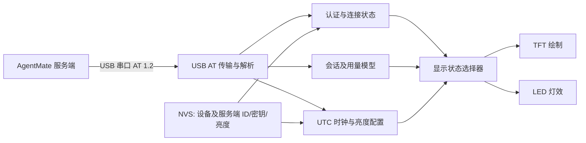
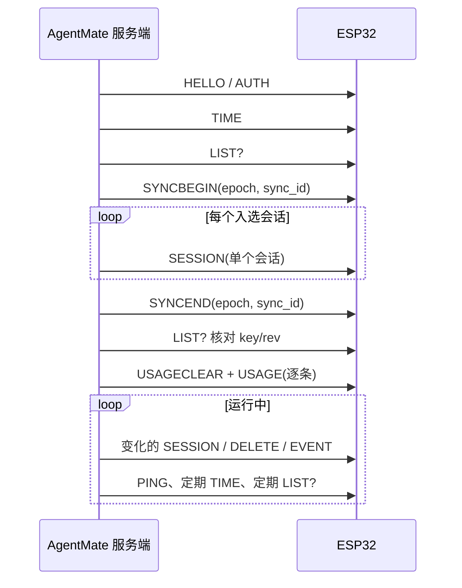

> 当前协议为 2：设备只接收本机 AgentMate 汇总后的投影；SESSION 包含 host_label 和 session_short_name，标题为主机短名*Session短名。跨节点订阅、启停及持久化由电脑服务处理。旧配对章节仍属未来规划。

# AgentMate ESP32 设备侧软件设计方案

> **一期实现更新（2026-10-01）**：当前固件首次烧录进入产测模式，产测完成后经 `AT+MODE=NORMAL` 进入正常模式。正常模式经 `AT+HELLO=2,<nonce>` 发现后直接接收业务命令；配对、四位码和 HMAC 认证调整为二期规划。本文旧版配对/认证流程章节仅保留为二期设计参考；一期线格式及命令可用性以 [AT 指令指南](agentmate_at_command_guide.md) 为准。当前原型的 AT 通道为 CH340 桥接的 UART0（115200 8N1）；运行期和 bootloader 常规日志关闭，应用日志仅使用可开关的 `+LOG:` 行，ROM 复位字节在发现前丢弃。

文档版本：**V0.3**  
日期：**2026-10-01**  
目标硬件：ESP32-C3、240×240 GC9A01 圆形 TFT、16 颗 RGB LED 灯环  
协议依据：[AT 指令指南 1.1](agentmate_at_command_guide.md)；产品依据：[PRD V0.3](agentmate_prd.md)

## 1. 目标与边界

设备通过 USB 串口接收 AgentMate 本地服务投影后的状态，保存有限数量的会话和 provider 用量，显示当前最需要关注的信息。设备不直接采集 Codex 或 Claude Code 数据，也不推断 Agent 的工作细分阶段。

首版包含 USB 连接、设备屏幕四位码配对、身份认证、时间同步、会话及用量同步、状态显示、一次性提醒、亮度设置。**不包含软件升级、Wi-Fi、设备网页配置**；四位码由用户在电脑上的 AgentMate 本机网页面板输入。本文是固件实现设计；指令的线格式、字段和错误码以 AT 指令指南为准。

当前工程已将原 TFT 与 LED 循环硬件演示替换为设备应用。基础版固件提供 USB AT、固定容量状态表、英文界面和屏幕旋转；服务端对接与真机联调仍需进行。

## 2. 总体架构

| 模块 | 责任 | 主要接口/数据 |
|---|---|---|
| `usb_at` | USB 收发、行缓冲、串行命令调度、响应编码 | 一次只处理一条命令；单行 ≤256 字节 |
| `identity` | 持久设备/服务端 ID、四位码窗口、密钥、nonce 与 HMAC 验证 | `HELLO`、`PAIRBEGIN`、`PAIRCOMMIT`、`AUTH` |
| `device_clock` | UTC 校时与单调计时 | `TIME`、`TIME?`、有效性及校时年龄 |
| `session_store` | 固定槽会话、epoch/rev、同步标记、`LIST?`/`GET` | `SYNCBEGIN`、`SESSION`、`DELETE`、`SYNCEND` |
| `usage_store` | 固定槽 provider 用量 | `USAGEBEGIN`、`USAGE`、`USAGEEND`、`USAGECLEAR` |
| `alert_store` | 最近 32 个 event ID 与当前短时提醒 | `EVENT` |
| `ui_model` | 连接状态、聚焦会话、页面选择、显示数据快照 | 仅消费已校验的模型变化 |
| `tft_ui` / `led_ui` | 文字、图形与灯效渲染 | 唯一持有各自硬件驱动句柄 |
| `settings` | NVS 配置、亮度和旋转应用 | `TFTBRIGHT`、`LEDBRIGHT`、`TFTROTATE` |

USB 解析任务只做有界解析和模型更新，不在命令处理路径执行整屏绘制或长动画。更新后给 UI 任务发送“模型已变化”通知；重复通知可合并。UI 任务读取一致的数据快照并独占 TFT/LED 驱动。`OK` 表示指令已通过校验并成功写入模型；亮度设置须在驱动应用及 NVS 保存成功后回复 `OK`，不等待后续屏幕重绘。

建议初版编译配置为 `max_sessions=8`、`max_usage_entries=4`，最终以 `HELLO` 实际报告值为准；容量可在 1～16 个会话内调整。使用固定数组及长度受限的短标识，不保存提示词、目录或原始 session ID。不分配 240×240×2 字节的全屏 RGB565 缓冲，优先使用小块绘制/行缓冲以控制 ESP32-C3 内存占用。

## 3. USB 发现、认证与连接状态

### 3.1 串口与设备发现

**发现动作在电脑服务端执行**：枚举候选 USB 串口、发送 `AT+HELLO`，检查协议标识、版本和 nonce 回显。若本机已有该设备的密钥，再验证 proof 并执行 `AT+AUTH`；没有可验证的 proof 时只能认定为协议兼容，进入四位码配对，不能直接同步业务数据。设备侧只需稳定提供可打开的串口和正确响应；VID/PID 只能帮助缩小候选范围，不能作为设备身份。

当前原型通过 CH340 将 ESP32-C3 UART0（GPIO20/21）连接到电脑，AT 通道使用 `115200 8N1`。`sdkconfig.defaults` 关闭运行期控制台与 bootloader 常规日志，应用日志只通过 `+LOG:` 行输出；ROM 复位信息可能仍出现在串口，服务端应在设备启动稳定后清空输入并发送 `HELLO`。GPIO18/19 保留给将来的原生 USB 硬件版本。

解析器按字节收集 ASCII 行，接受 `\r\n` 和 `\n`，保留连续逗号产生的空字段，拒绝多余字段、非法字符和溢出数值。行长超过 256 字节（含行尾）时丢弃直到换行，然后只回复一次 `LINE_TOO_LONG`；未知命令回复 `UNKNOWN_COMMAND`。每条命令以独立 `OK` 或 `ERROR` 结束。业务命令在认证前返回 `UNAUTHORIZED`。解析器不因为坏输入重启设备。

### 3.2 二期规划：四位码配对与长期认证

首次启动用加密随机数生成 `device_id` 并保存到 NVS，不预置配对密钥。电脑服务端在本机安装期间持久保存 `server_id`；设备的单个配对记录保存该 `server_id` 与 256 位长期密钥。`HELLO` 每次生成新 `device_nonce`：请求来自已配对 `server_id` 时返回 HMAC proof；未配对或请求来自另一台电脑时返回 `-`。只有完成后续 `AUTH` 才允许会话、用量、时间和亮度命令。

服务端发现未与本机配对的设备后，自动发送一次 `PAIRBEGIN`。设备使用加密随机数生成 `pair_id` 和四位码（允许 `0042` 这样的前导零），屏幕显示四位码、设备 ID 后八位及 120 秒倒计时；串口响应只含 `pair_id` 和剩余秒数。窗口内重复 `PAIRBEGIN` 不更换数字。用户在本机网页的对应设备卡片输入码，服务端先持久保存待确认的随机 256 位密钥，再发送 `PAIRCOMMIT=<pair_id>,<pin>,<key_hex>`。设备只在窗口内、三次尝试内接受正确四位码；成功时把 `server_id` 与新密钥作为一份完整记录写入 NVS，然后清屏并返回 `OK`。新电脑配对成功后替换旧电脑；失败、过期或 NVS 写入失败保留旧配对。第三次错误后冷却 300 秒。四位码不写日志、不存 NVS，也不作为长期密钥；首次密钥经本机 USB 串口发送。

服务端收到成功结果后必须重新 `HELLO`/`AUTH` 验证密钥，才能开始业务同步。如果提交后的 `OK` 丢失，先尝试用待确认密钥重新握手，而不是直接让用户重输。新 `HELLO`、USB 断开或窗口到期使未完成的配对窗口失效。窗口过期后设备隐藏数字，服务端不自动反复触发；网页可在冷却结束后请求新的窗口。已有密钥但认证失败时屏幕显示认证异常，由用户在网页手动重新配对。显式编译的开发调试固件仍可使用 `AUTH=-`，屏幕标明“未验证”；正式固件拒绝该方式。

### 3.3 一期连接状态机

上电先播放启动页 2～5 秒，协议任务同时监听 UART。正常模式退出启动后先显示连接页，产测则交给现有测试页面。有效 HELLO 进入 HANDSHAKE，SYNCBEGIN 进入 SYNCING，SYNCEND 完成后进入 ONLINE；时钟是否有效不改变业务连接状态。连续 30 秒无有效命令时清空会话、用量、事件、用量支持标记与信息页请求，回 WAIT_HOST。配对和认证仍为二期，相关命令返回 UNSUPPORTED_FEATURE。

## 4. 时间同步

TIME 同时传 UTC Unix 毫秒和主机当前 UTC 偏移分钟；USAGE 单独传重置时刻的偏移。系统时钟保持 UTC，任务、超时和动画使用单调时钟。待机／设备信息页按当前偏移显示本地日期时间，用量页按重置偏移显示未来重置时刻；缺失时用占位，屏上不显示 UTC 或校时状态。服务端在连接后、每 30 分钟和时区／夏令时变化时刷新。具体格式以 AT 指南为准。

## 5. Session 同步与存储

### 5.1 数据模型

每个会话槽保存 `key`、`rev`、`provider`、`state`、`last_task`、`finished_at`、`task_seconds`、应用该版本时的单调时间、Claude context 四字段及本轮同步的 `seen` 位。设备全局保存当前 `epoch`、`sync_id`、同步中标志和已确认的会话数量。会话仅驻留 RAM；亮度、身份和密钥才进入 NVS。服务端负责按优先级裁剪到设备容量，设备不自行从未下发的会话中挑选。

`task_seconds` 是当次任务在命令生成时已经持续的秒数，范围 `0–4294967295`，没有当次任务时为 `0`。它不是 Unix 时间戳，显示不依赖 UTC 是否已校准。设备在应用新版本时记下这个基准和当时的单调时间。状态为 `working`、`thinking`、`waiting_for_input` 或 `permission_required` 时，显示时长等于基准加上此后经过的整秒；`stale` 和已结束任务保持基准不变。服务端不会因为秒数流逝而重发 `SESSION`。`GET` 返回保存的基准，不返回本地累加后的显示值。

`SESSION` 对 `(epoch,key,rev)` 幂等：同版本只确认，不重复触发动画，也不重置任务计时基准；较旧版本返回 `STALE_REV`；更新版本覆盖对应槽，并用新的 `task_seconds` 重建计时基准。`key` 是服务端短键，不在设备上反查原始 session ID。新增槽满返回 `CAPACITY`；`DELETE` 对不存在 key 仍返回 `OK`。设备可保存 `ended` 字段以遵循协议，但正常服务端会对退出会话发送 `DELETE`，显示层不把 `ended` 当作活动会话。

### 5.2 首次同步与增量更新

新 `epoch` 的 `SYNCBEGIN` 立即清空旧 epoch 的会话、全部 provider 用量和事件去重缓存；同一 epoch 的 `SYNCBEGIN` 把现有会话的 `seen` 位置为否。每条成功的 `SESSION` 将对应槽标记为已见；`SYNCEND` 删除未见条目并结束同步。`LIST?` 返回当前 epoch、条数、容量及每个 key/rev；`GET` 返回指定会话的全部协议字段。服务端据此修复丢失或错误的条目。同步中若端口断开、超时或再次握手，取消本轮 `sync_id`，禁止迟到的 `SYNCEND` 提交。

初次同步期间显示“正在同步”，不把逐条到达的中间集合当成最终状态；`SYNCEND` 成功后一次发布给 UI。运行中单条 `SESSION`/`DELETE` 成功即发布。若同一 epoch 的同步中断，RAM 可保留当时内容供后续核对，但 UI 显示同步异常；连接超时后按第 3 节清空。跨 epoch 不显示旧会话。服务端初次同步前若旧槽已满，应先删除不再入选的 key；设备仍按 `CAPACITY` 严格保护容量。

### 5.3 Context 与任务事件

Claude 会话的四个 context 字段同时为数字时表示已知；同时为 `?` 表示暂时未知。Codex 的四字段必须全为空，表示设备协议暂不支持 Codex context。解析器拒绝混合空值、`?` 与数字，不把未知显示为 0%。Claude context 可在会话页以 `已用/窗口` 和百分比显示；字段全空的 Codex 不显示 context 栏。

`last_task` 是会话最近结果的静态信息；`EVENT` 是一次性提醒，两者分开。设备缓存最近至少 32 个 `event_id`，同 ID 重发只回复 `OK` 而不再次播放。`EVENT` 先校验 epoch、字段和时间，再进入短时提醒队列；服务端重连不重放历史事件。`EVENT` 不改变会话的持久 `state`，提醒结束后重新依据最新 `SESSION` 显示。结果事件即使紧接着 `DELETE` 到来，仍可完成当前短时提示；之后不保留已删除会话的常驻页面。

## 6. Provider 用量同步与显示

保留现有最多 4 条用量表，按 provider、metric、window 唯一更新。UI 只读取 Codex 的 18000 秒和 604800 秒窗口，同一 metric 配对，按 metric 字典序选第一组；重复同档按 window_key 字典序选择。显示剩余百分比而非已用值。未知读数保留窗口时长；USAGECLEAR 可清空失效记录。成功发布任一目标窗口即标记本次连接支持用量，不依赖 Session 或活动时间；清除记录后保留支持标记，显示未知占位；重连、新 epoch、断线或重启重置标记。其他 provider 不影响选页。

## 7. 屏幕与 LED 显示策略

### 7.1 一期页面层级

工作流按首次命中选择：等待授权／输入 → 完成态 → 工作／思考／stale → 待机。同组仅按槽位轮播，所有子页统一 10 秒（含用量／时钟）。新成员入队不抢切、不重置计时；组升级和当前成员离开立即重选。ready 不生成 Session 页。EVENT 保留去重和信息页关闭，不再增加 4 秒驻留。完成态由服务端 SESSION／DELETE 退出。

正常业务页面使用固定连接图标 header，无页脚时钟。主状态移除引导图标，在 137×42 px 圆角框内居中，文字与对应灯环同色。动态边框以 10 fps 持续播放，包括冻结结果／stale；key、状态和代际变化重启，普通数据更新不重启。动态区域 143×48 px 局部合成，启动阶段准备距离／周长缓存 13728 字节，不新增全屏颜色缓冲。Session 为 36 px provider 图标与右栏身份／目录／状态／时长，Context 精确值分三行显示，未知或不支持隐藏。目录经百分号编码 UTF-8 下发，设备按像素宽度省略，字符覆盖 ASCII 与 GB2312，其他字符替代显示。

### 7.2 设备信息页

SHOWINFO 显式拉起，常用 10 秒，可关闭或续期。显示身份四行、亮度两行、日期时间两行，不轮播、不显示倒计时。新批准／输入状态或有效同组事件抢占后关闭且不恢复。灯环保留进入时的持续效果；退出后按当前显示会话选择。

### 7.3 自绘与灯环

采用固定中文子集、动态目录字库、4-bit 灰度掩码和 RGB565 局部合成。生成资源随源码提交；驱动不解析 SVG 或桌面字体。共用一个 240×32 像素缓冲，没有全屏帧缓冲。相同场景不提交 SPI；文字变化仅重绘旧／新脏区，并合成覆盖在该区域的其他元素以消除残影。普通主体转场 200 ms、10 fps，告警立即切入；header 独立更新。四种旋转保持相同布局。

灯环跟随实际显示 Session，20 Hz 调度且跳过相同帧。工作为连续六灯固定明暗尾迹，思考为对向三灯慢速旋转，连接中为对向四灯快速旋转，方向固定为索引递增；stale 固定六灯交替明暗。授权全环短双闪，输入固定八灯长闪；成功分四扇区填满，失败全环短单闪，取消蓝色固定八灯单闪；未连接红色固定六灯间歇提示，待机熄灭。全部档位乘以用户亮度百分比，不引入呼吸或随机换向。颜色与时序边界见 UI 需求第 11 节。无 EVENT 额外闪光，动画不修改 NVS 亮度。

## 8. NVS、并发与异常恢复

NVS 仅保存 `device_id`、单份完整配对记录（`server_id` 与长期密钥）、TFT 背光亮度、LED 亮度和 TFT 旋转角度。四位码、`pair_id`、窗口截止时间、错误次数、会话、用量、epoch、event ID、当前提醒、UTC 校时有效位均不持久化。配对记录以单个带版本/校验的 NVS blob 提交，新记录写入失败时保留旧记录，不报告成功。默认亮度为 TFT `192/255`、LED `64/255`，默认旋转角度为 `0°`。公开亮度命令取值 `0–100` 整数百分比，驱动与 NVS 保持 `0–255`；旋转命令 `TFTROTATE` 只接受 `0`、`90`、`180`、`270`，应用并保存后回复成功，重新绘制当前页面。驱动不支持可调背光时返回 `UNSUPPORTED_FEATURE`。NVS 写入失败返回 `STORAGE_ERROR`，不报告“已保存”。

单个 `usb_at` 任务串行处理所有 AT 命令，因而 `SESSION`、`DELETE` 与 `LIST?` 不会互相穿插；UI 通过短时互斥锁复制快照，绘图在锁外完成。`PING`、`TIME?` 等轻量指令的响应不等待 UI。内部定时器/任务用单调时钟检查 30 秒租期和轮换时间。显示驱动报错只影响显示层并记录诊断，不丢失串口模型；协议存储容量错误只拒绝当前命令，不破坏已有条目。

异常处理原则：

| 场景 | 设备动作 |
|---|---|
| 串口出现坏行、乱码或超长行 | 丢弃当前行、返回对应错误、等待下一行 |
| `AUTH` 失败 | 不开放业务命令；屏幕显示认证失败 |
| 四位码输入错误或超时 | 返回 `PAIR_MISMATCH` / `PAIR_EXPIRED`；第三次错误返回 `PAIR_LOCKED`，关闭窗口并冷却 300 秒，保留旧配对 |
| 新配对写入 NVS 失败 | 返回 `STORAGE_ERROR`，旧 `server_id` 和密钥继续有效 |
| `SESSION` / `USAGE` 容量满 | 返回 `CAPACITY`，不覆盖其他条目 |
| 收到更旧 `rev` 或错误 `epoch` | 分别返回 `STALE_REV` / `BAD_STATE`，维持现有模型 |
| `SYNCBEGIN` 后中断 | 不提交最终 UI 集合；下次重连重新握手和全量核对 |
| 30 秒无有效命令、USB 拔出 | 清除远端数据和事件、撤销认证，显示服务不可用 |
| `TIME` 失败 | 保持时钟无效或上次有效值，显示校时异常；计时仍用单调时钟 |
| 显示硬件故障 | 协议仍回应；固件记录错误，不让通信任务卡在重绘中 |

## 9. 实施与验收

一期实现与服务端适配说明见 [UI 实施与验收记录](agentmate_ui_implementation.md)。构建必须通过 idf.py build／size；主机测试使用真实场景构建器和渲染器，验证优先级、10 秒统一轮播、支持标记生命周期、脏区与完整重绘一致。串口测试验证协议格式、重试、未知读数、信息页和重同步。像素／灯效最终仍需真机目视验收；配对二期和产测改版不属于本次交付。

### 用量刷新补充（2026-10-03）

正常用量刷新通过 BEGIN／USAGE／END 整批原子提交，暂存表最多 4 项且不复制进 UI 快照。END 前继续显示已提交记录，不因每分钟采样短暂切到待机。采集不可用才清除。用量同页更新不淡入、不清屏；窗口标题放大至 19 px，移除横线和重置标签。5 小时重置只显示 HH:mm，一周日期与时间分行。字段、幂等及超时行为以 AT 指令指南为准。
