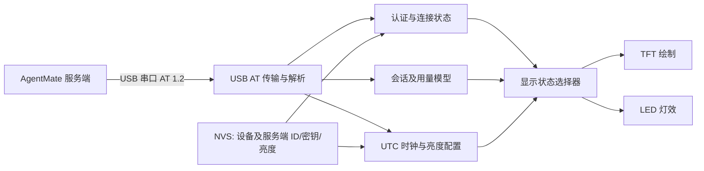
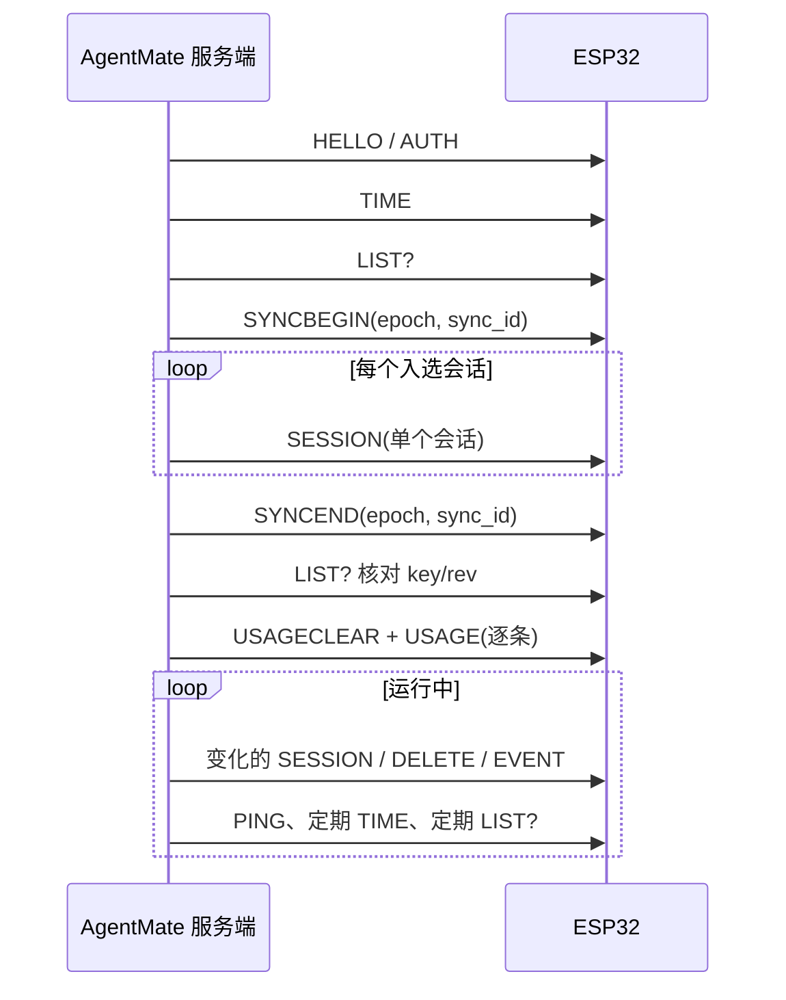

# AgentMate ESP32 设备侧软件设计方案

文档版本：**V0.3**  
日期：**2026-10-01**  
目标硬件：ESP32-C3、240×240 GC9A01 圆形 TFT、16 颗 RGB LED 灯环  
协议依据：[AT 指令指南 1.1](agentmate_at_command_guide.md)；产品依据：[PRD V0.3](agentmate_prd.md)

## 1. 目标与边界

设备通过 USB 串口接收 AgentMate 本地服务投影后的状态，保存有限数量的会话和 provider 用量，显示当前最需要关注的信息。设备不直接采集 Codex 或 Claude Code 数据，也不推断 Agent 的工作细分阶段。

首版包含 USB 连接、设备屏幕四位码配对、身份认证、时间同步、会话及用量同步、状态显示、一次性提醒、亮度设置。**不包含软件升级、Wi-Fi、设备网页配置**；四位码由用户在电脑上的 AgentMate 本机网页面板输入。本文是固件实现设计；指令的线格式、字段和错误码以 AT 指令指南为准。

当前工程已将原 TFT 与 LED 循环硬件演示替换为设备应用。基础版固件提供 USB AT、固定容量状态表、英文界面和屏幕旋转；服务端对接与真机联调仍需进行。

## 2. 总体架构

| 模块 | 责任 | 主要接口/数据 |
|---|---|---|
| `usb_at` | USB 收发、行缓冲、串行命令调度、响应编码 | 一次只处理一条命令；单行 ≤256 字节 |
| `identity` | 持久设备/服务端 ID、四位码窗口、密钥、nonce 与 HMAC 验证 | `HELLO`、`PAIRBEGIN`、`PAIRCOMMIT`、`AUTH` |
| `device_clock` | UTC 校时与单调计时 | `TIME`、`TIME?`、有效性及校时年龄 |
| `session_store` | 固定槽会话、epoch/rev、同步标记、`LIST?`/`GET` | `SYNCBEGIN`、`SESSION`、`DELETE`、`SYNCEND` |
| `usage_store` | 固定槽 provider 用量 | `USAGE`、`USAGECLEAR` |
| `alert_store` | 最近 32 个 event ID 与当前短时提醒 | `EVENT` |
| `ui_model` | 连接状态、聚焦会话、页面选择、显示数据快照 | 仅消费已校验的模型变化 |
| `tft_ui` / `led_ui` | 文字、图形与灯效渲染 | 唯一持有各自硬件驱动句柄 |
| `settings` | NVS 配置、亮度和旋转应用 | `TFTBRIGHT`、`LEDBRIGHT`、`TFTROTATE` |

USB 解析任务只做有界解析和模型更新，不在命令处理路径执行整屏绘制或长动画。更新后给 UI 任务发送“模型已变化”通知；重复通知可合并。UI 任务读取一致的数据快照并独占 TFT/LED 驱动。`OK` 表示指令已通过校验并成功写入模型；亮度设置须在驱动应用及 NVS 保存成功后回复 `OK`，不等待后续屏幕重绘。

建议初版编译配置为 `max_sessions=4`、`max_usage_entries=8`，最终以 `HELLO` 实际报告值为准；容量可在 1～16 个会话内调整。使用固定数组及长度受限的短标识，不保存提示词、目录或原始 session ID。不分配 240×240×2 字节的全屏 RGB565 缓冲，优先使用小块绘制/行缓冲以控制 ESP32-C3 内存占用。

## 3. USB 发现、认证与连接状态

### 3.1 串口与设备发现

**发现动作在电脑服务端执行**：枚举候选 USB 串口、发送 `AT+HELLO`，检查协议标识、版本和 nonce 回显。若本机已有该设备的密钥，再验证 proof 并执行 `AT+AUTH`；没有可验证的 proof 时只能认定为协议兼容，进入四位码配对，不能直接同步业务数据。设备侧只需稳定提供可打开的串口和正确响应；VID/PID 只能帮助缩小候选范围，不能作为设备身份。

首版以 ESP32-C3 原生 USB Serial/JTAG 的串口数据通道作为 AT 通道，GPIO18/19 留给 USB。当前工程的 `sdkconfig` 把 USB Serial/JTAG 同时设为次级控制台，正式固件必须将普通日志从协议数据通道移开（例如只走 UART0 或关闭控制台输出）；不能让 ESP-IDF 日志、启动信息和 AT 响应交叉。带 USB-UART 桥的开发板只有在该桥对应的 UART 也与日志隔离后才能用作协议通道。`115200 8N1` 是 AT 指南的串口配置；原生 USB 虚拟串口并无实际 UART 波特率。

解析器按字节收集 ASCII 行，接受 `\r\n` 和 `\n`，保留连续逗号产生的空字段，拒绝多余字段、非法字符和溢出数值。行长超过 256 字节（含行尾）时丢弃直到换行，然后只回复一次 `LINE_TOO_LONG`；未知命令回复 `UNKNOWN_COMMAND`。每条命令以独立 `OK` 或 `ERROR` 结束。业务命令在认证前返回 `UNAUTHORIZED`。解析器不因为坏输入重启设备。

### 3.2 四位码配对与长期认证

首次启动用加密随机数生成 `device_id` 并保存到 NVS，不预置配对密钥。电脑服务端在本机安装期间持久保存 `server_id`；设备的单个配对记录保存该 `server_id` 与 256 位长期密钥。`HELLO` 每次生成新 `device_nonce`：请求来自已配对 `server_id` 时返回 HMAC proof；未配对或请求来自另一台电脑时返回 `-`。只有完成后续 `AUTH` 才允许会话、用量、时间和亮度命令。

服务端发现未与本机配对的设备后，自动发送一次 `PAIRBEGIN`。设备使用加密随机数生成 `pair_id` 和四位码（允许 `0042` 这样的前导零），屏幕显示四位码、设备 ID 后八位及 120 秒倒计时；串口响应只含 `pair_id` 和剩余秒数。窗口内重复 `PAIRBEGIN` 不更换数字。用户在本机网页的对应设备卡片输入码，服务端先持久保存待确认的随机 256 位密钥，再发送 `PAIRCOMMIT=<pair_id>,<pin>,<key_hex>`。设备只在窗口内、三次尝试内接受正确四位码；成功时把 `server_id` 与新密钥作为一份完整记录写入 NVS，然后清屏并返回 `OK`。新电脑配对成功后替换旧电脑；失败、过期或 NVS 写入失败保留旧配对。第三次错误后冷却 300 秒。四位码不写日志、不存 NVS，也不作为长期密钥；首次密钥经本机 USB 串口发送。

服务端收到成功结果后必须重新 `HELLO`/`AUTH` 验证密钥，才能开始业务同步。如果提交后的 `OK` 丢失，先尝试用待确认密钥重新握手，而不是直接让用户重输。新 `HELLO`、USB 断开或窗口到期使未完成的配对窗口失效。窗口过期后设备隐藏数字，服务端不自动反复触发；网页可在冷却结束后请求新的窗口。已有密钥但认证失败时屏幕显示认证异常，由用户在网页手动重新配对。显式编译的开发调试固件仍可使用 `AUTH=-`，屏幕标明“未验证”；正式固件拒绝该方式。

### 3.3 连接状态机

| 状态 | 进入条件 | 设备显示 | 退出条件 |
|---|---|---|---|
| `WAIT_HOST` | 启动、USB 断开或连接超时 | “等待 AgentMate 服务”，会话数为 0 | 收到有效 `HELLO` |
| `HANDSHAKE` | `HELLO` 格式与版本正确 | “正在连接” | `AUTH` 成功、进入配对或认证失败 |
| `PAIRING` | `PAIRBEGIN` 成功 | 四位码、设备 ID 后八位及倒计时；不显示旧会话 | `PAIRCOMMIT` 成功、窗口过期、断开或新 `HELLO` |
| `UNPAIRED` | 未与本机配对、窗口过期或认证失败 | “等待配对/认证失败”；冷却期显示剩余时间 | 新窗口或认证成功 |
| `SYNCING` | `AUTH` 成功，等待校时与首次会话核对 | “正在同步”，不展示旧 epoch 数据 | `SYNCEND` 成功后按校时结果进入 `ONLINE` 或 `DEGRADED`；或超时 |
| `ONLINE` | 初次同步完成、时间有效且持续收到有效命令 | 正常会话/用量页面，连接标记常显 | 校时异常、30 秒无有效命令或 USB 断开 |
| `DEGRADED` | 已认证但同步失败或时间尚未校准 | 显示对应异常，保留可确定的本地状态 | 修复成功或连接超时 |

`SYNCING` 的结束由本地跟踪首次会话同步阶段；由于 AT 1.2 没有“用量同步结束”命令，用量页面在 `USAGECLEAR`/`USAGE` 到达前显示“暂无数据”，不得延迟会话上线。若不支持用量，`max_usage_entries=0` 也可上线。时间未校准时进入 `DEGRADED`，仍可显示已同步的会话。显示服务连接的依据是**认证成功且最近收到有效的已认证命令**，不是 USB 供电、串口打开或 Agent 会话是否 `stale`。

设备使用单调时钟记录最后一条成功解析并获授权的业务命令时间。服务端通常每 10 秒发送 `PING`；设备回复相同 nonce 和 uptime。已认证连接连续 30 秒没有有效命令，或明确检测到 USB 断开时：撤销当前认证、清空会话/用量/一次性提醒、清除同步中状态，切换为 `WAIT_HOST`。坏命令、未认证探测不延长这 30 秒；配对窗口独立按 120 秒倒计时。服务端重连必须重新 `HELLO`/`AUTH` 并完整同步。设备不会主动向电脑发送业务消息。

## 4. 时间同步

电脑系统 UTC 是唯一时间源。设备启动时标记 UTC 为**无效**，仅使用 `esp_timer_get_time()` 等单调计时源驱动超时和动画。认证后服务端发送 `AT+TIME=<unix_ms>`；设备校验参数、设置系统 UTC 时钟，并记录设置时的单调时间。设置成功才回复 `+TIME:<device_unix_ms>,<uptime_ms>` 与 `OK`。`TIME?` 返回当前 UTC、运行时长和最近校时年龄；未校时返回协议规定的 `0,<uptime_ms>,-`。

服务端在首次连接和之后每 30 分钟校时，并以往返中点估算偏差；超出 100 毫秒时重试。设备不自行经网络校时。校时可能让墙上时间跳变，但心跳 30 秒期限、提醒持续时间和页面轮换都使用单调时钟，不受校时影响。时间设置失败返回 `TIME_ERROR`，连接可保持但屏幕显示“时间未校准”，隐藏依赖准确日期的重置倒计时。

屏幕首版将日期时间明确标为 **UTC**，避免在协议不传时区的情况下把 UTC 当作本地时间。顶部可显示 `HH:MM UTC`；设备状态页显示完整 `YYYY-MM-DD HH:MM:SS UTC`、校时年龄与 uptime。未校时时显示 `--:-- UTC` 和“等待校时”。会话 `finished_at`、用量 `reset_at` 等 Unix 秒仅在 UTC 有效时换算显示；源时间戳本身不因校时改写。

## 5. Session 同步与存储

### 5.1 数据模型

每个会话槽保存 `key`、`rev`、`provider`、`state`、`last_task`、`finished_at`、`task_seconds`、应用该版本时的单调时间、Claude context 四字段及本轮同步的 `seen` 位。设备全局保存当前 `epoch`、`sync_id`、同步中标志和已确认的会话数量。会话仅驻留 RAM；亮度、身份和密钥才进入 NVS。服务端负责按优先级裁剪到设备容量，设备不自行从未下发的会话中挑选。

`task_seconds` 是当次任务在命令生成时已经持续的秒数，范围 `0–4294967295`，没有当次任务时为 `0`。它不是 Unix 时间戳，显示不依赖 UTC 是否已校准。设备在应用新版本时记下这个基准和当时的单调时间。状态为 `working`、`waiting_for_input` 或 `permission_required` 时，显示时长等于基准加上此后经过的整秒；`stale` 和已结束任务保持基准不变。服务端不会因为秒数流逝而重发 `SESSION`。`GET` 返回保存的基准，不返回本地累加后的显示值。

`SESSION` 对 `(epoch,key,rev)` 幂等：同版本只确认，不重复触发动画，也不重置任务计时基准；较旧版本返回 `STALE_REV`；更新版本覆盖对应槽，并用新的 `task_seconds` 重建计时基准。`key` 是服务端短键，不在设备上反查原始 session ID。新增槽满返回 `CAPACITY`；`DELETE` 对不存在 key 仍返回 `OK`。设备可保存 `ended` 字段以遵循协议，但正常服务端会对退出会话发送 `DELETE`，显示层不把 `ended` 当作活动会话。

### 5.2 首次同步与增量更新

新 `epoch` 的 `SYNCBEGIN` 立即清空旧 epoch 的会话、全部 provider 用量和事件去重缓存；同一 epoch 的 `SYNCBEGIN` 把现有会话的 `seen` 位置为否。每条成功的 `SESSION` 将对应槽标记为已见；`SYNCEND` 删除未见条目并结束同步。`LIST?` 返回当前 epoch、条数、容量及每个 key/rev；`GET` 返回指定会话的全部协议字段。服务端据此修复丢失或错误的条目。同步中若端口断开、超时或再次握手，取消本轮 `sync_id`，禁止迟到的 `SYNCEND` 提交。

初次同步期间显示“正在同步”，不把逐条到达的中间集合当成最终状态；`SYNCEND` 成功后一次发布给 UI。运行中单条 `SESSION`/`DELETE` 成功即发布。若同一 epoch 的同步中断，RAM 可保留当时内容供后续核对，但 UI 显示同步异常；连接超时后按第 3 节清空。跨 epoch 不显示旧会话。服务端初次同步前若旧槽已满，应先删除不再入选的 key；设备仍按 `CAPACITY` 严格保护容量。

### 5.3 Context 与任务事件

Claude 会话的四个 context 字段同时为数字时表示已知；同时为 `?` 表示暂时未知。Codex 的四字段必须全为空，表示设备协议暂不支持 Codex context。解析器拒绝混合空值、`?` 与数字，不把未知显示为 0%。Claude context 可在会话页以 `已用/窗口` 和百分比显示；字段全空的 Codex 不显示 context 栏。

`last_task` 是会话最近结果的静态信息；`EVENT` 是一次性提醒，两者分开。设备缓存最近至少 32 个 `event_id`，同 ID 重发只回复 `OK` 而不再次播放。`EVENT` 先校验 epoch、字段和时间，再进入短时提醒队列；服务端重连不重放历史事件。`EVENT` 不改变会话的持久 `state`，提醒结束后重新依据最新 `SESSION` 显示。结果事件即使紧接着 `DELETE` 到来，仍可完成当前短时提示；之后不保留已删除会话的常驻页面。

## 6. Provider 用量同步与显示

设备使用独立的固定用量表，以 `(provider,metric_key,window_key)` 为键，记录 `used_bp`、`reset_at`、`window_seconds`、`updated_at`。总条目数不超过 `max_usage_entries`。当前服务端先同步 Codex 账号配额；协议允许以后同步其他 provider，但设备不把 provider 用量归属到某个 session。

`USAGECLEAR=<epoch>,<provider>` 清空该 provider 的所有记录；服务端随后逐条 `USAGE` 写入当前集合。无数据、采集失败或 `available=false` 时只收到清除命令，页面显示“用量不可用”。`used_bp=-` 表示该窗口数值未知，必须显示“未知”，不能画成 0%。收到新 epoch 或连接失活时清空整张用量表。设备不通过旧记录外推新的使用量。

用量页显示 provider、指标短键、窗口名、已用比例，以及可信时的“UTC 重置时间”。现有 AT 字段仅提供短键，不提供适合用户阅读的套餐名称；首版可以把 `primary` / `secondary` 显示为“主窗口”/“次窗口”，其余键原样显示。若当前 UTC 已超过 `reset_at` 而尚无新采样，旧比例标记为“等待更新”；若 `updated_at` 明显早于当前时间且超过约 3 个采集周期（当前 Codex 采集周期约 1 分钟），显示“数据较旧”。这两种情况不清除协议表项，但停止把旧比例当作实时值。时间未校准时只显示已用比例和“重置时间未知”。

## 7. 屏幕与 LED 显示策略

### 7.1 页面层级

圆屏固定保留小型状态区：服务连接图标/文字、`HH:MM UTC` 或未校时标记、当前已同步会话数。主体页面按以下优先级选择：

1. 未连接、配对中、未配对或同步中：显示对应设备状态页；配对页固定显示四位码与倒计时，不显示旧会话。
2. `permission_required` / `waiting_for_input`：固定显示优先级最高的会话；多个同级会话每 6 秒轮换。
3. 一次性结果提醒：在没有更高优先级待处理会话时显示约 4 秒；权限提醒可持续到服务端会话状态改变，短时 `EVENT` 本身不永久锁屏。
4. 其他会话：按 `working → stale → ready → initializing → offline` 排序，每 6 秒轮换；会话数为 0 时显示“暂无活动会话”。
5. 用量页：无待处理会话时每约 20 秒插入一页，停留约 6 秒；无有效用量时不参与轮换。
6. 设备状态页：无待处理会话时定期短暂插入，或在连接/校时状态变化时显示。由于首版没有按钮，用户仍可通过常显状态区确认连接与时间。

会话页至少显示 provider（Codex/Claude）、短 key（如 `s2`）、当前状态、人类可读的会话序号（如 `2/4`），以及当次任务时长。进行中状态按第 5.1 节在基准上逐秒增加；`stale` 和已结束任务显示冻结秒数。基准为 `0` 且没有进行中任务时不显示时长。不足 60 秒显示为 `42s`，达到 60 秒显示为 `m:ss`（如 `3:05`）。不显示服务端未传来的项目名、任务标题或进度百分比。Claude context 有效时增加百分比与 token 数；长数字用缩写，但关键百分比不取代状态文字。显示区域避开圆屏四角。屏幕使用文字和图形同时表达状态，不单靠颜色。

| `SESSION.state` | 屏幕文案 | LED 基础表现 |
|---|---|---|
| `permission_required` | 需要批准，并显示持续时长 | 橙色双脉冲，明显且持续 |
| `waiting_for_input` | 等待输入，并显示持续时长 | 黄色双脉冲，明显且持续 |
| `working` | 工作中，并显示持续时长 | 蓝色缓慢呼吸 |
| `stale` | 状态未更新 | 紫色低频闪烁 |
| `ready` | 就绪 | 柔和绿色常亮/低亮呼吸 |
| `initializing` | 初始化中 | 青色缓慢呼吸 |
| `offline` | 会话离线 | 灰白低亮，明确标注“会话” |
| 无会话且已连接 | 暂无活动会话 | 低亮静态状态 |
| 服务端未连接 | 等待 AgentMate 服务 | LED 熄灭或低亮提示，不能像正常工作态 |

灯效只反映当前焦点会话和连接状态；LED 页面选择与 TFT 同步。完成、失败、取消分别用短暂的绿色、红色、琥珀色提醒，并配有屏幕文字；一次性提醒结束后恢复基础灯效。亮度 0 时屏幕背光或灯环可完全关闭，设置不应改变模型中的连接与会话状态。动画采用非阻塞定时更新；TFT 只重绘变化区域，避免灯效或串口响应被整屏绘制拖慢。

### 7.2 设备状态页

设备状态页显示：连接状态（等待/配对中/认证/同步/在线/异常）、设备 ID 后 8 位、固件版本、已同步会话数/总容量、用量记录数/总容量、当前 UTC、最近校时年龄、运行时长。`PAIRING` 时四位码占主体位置，同时提示“在电脑 AgentMate 网页面板输入”；超时、三次错误或冷却时隐藏四位码并显示原因。正常状态页不显示密钥、HMAC 或旧 pin。连接状态与会话 `offline` 分开命名。设备重启后即使 RTC 留有时间，也在收到本次 `TIME` 前显示未校准。

### 7.3 基础版固件的界面实现

当前固件只绘制英文 ASCII，暂无中文字库。会话页使用服务端工程的 Codex、Claude SVG 原图生成的 48×48 RGB565 图标；源 SVG 和可预览 BMP 放在 `assets/provider_icons/`，`tools/generate_provider_icons.py` 生成编译期头文件，设备运行时不解析 SVG/BMP。圆屏每秒或模型变化时整页重绘，LED 目前使用静态颜色表示连接、配对、工作及待批准状态；上文描述的呼吸和双脉冲灯效、局部刷新属于后续 UI 完善项。

屏幕绘制方向可通过已认证的 `AT+TFTROTATE=<0|90|180|270>` 切换，`AT+TFTROTATE?` 查询当前角度。设备调用现有 GC9A01 驱动的四方向 MADCTL 旋转；布局在 240×240 圆屏坐标中重新绘制。角度保存在 NVS，重启后恢复，不影响会话与用量模型。

## 8. NVS、并发与异常恢复

NVS 仅保存 `device_id`、单份完整配对记录（`server_id` 与长期密钥）、TFT 背光亮度、LED 亮度和 TFT 旋转角度。四位码、`pair_id`、窗口截止时间、错误次数、会话、用量、epoch、event ID、当前提醒、UTC 校时有效位均不持久化。配对记录以单个带版本/校验的 NVS blob 提交，新记录写入失败时保留旧记录，不报告成功。默认亮度为 TFT `192/255`、LED `64/255`，默认旋转角度为 `0°`。亮度命令取值 `0–255`；旋转命令 `TFTROTATE` 只接受 `0`、`90`、`180`、`270`，应用并保存后回复成功，重新绘制当前页面。驱动不支持可调背光时返回 `UNSUPPORTED_FEATURE`。NVS 写入失败返回 `STORAGE_ERROR`，不报告“已保存”。

单个 `usb_at` 任务串行处理所有 AT 命令，因而 `SESSION`、`DELETE` 与 `LIST?` 不会互相穿插；UI 通过短时互斥锁复制快照，绘图在锁外完成。`PING`、`TIME?` 等轻量指令的响应不等待 UI。内部定时器/任务用单调时钟检查 30 秒租期和轮换时间。显示驱动报错只影响显示层并记录诊断，不丢失串口模型；协议存储容量错误只拒绝当前命令，不破坏已有条目。

异常处理原则：

| 场景 | 设备动作 |
|---|---|
| 串口出现坏行、乱码或超长行 | 丢弃当前行、返回对应错误、等待下一行 |
| `AUTH` 失败 | 不开放业务命令；屏幕显示认证失败 |
| 四位码输入错误或超时 | 返回 `PAIR_MISMATCH` / `PAIR_EXPIRED`；第三次错误返回 `PAIR_LOCKED`，关闭窗口并冷却 300 秒，保留旧配对 |
| 新配对写入 NVS 失败 | 返回 `STORAGE_ERROR`，旧 `server_id` 和密钥继续有效 |
| `SESSION` / `USAGE` 容量满 | 返回 `CAPACITY`，不覆盖其他条目 |
| 收到更旧 `rev` 或错误 `epoch` | 分别返回 `STALE_REV` / `BAD_STATE`，维持现有模型 |
| `SYNCBEGIN` 后中断 | 不提交最终 UI 集合；下次重连重新握手和全量核对 |
| 30 秒无有效命令、USB 拔出 | 清除远端数据和事件、撤销认证，显示服务不可用 |
| `TIME` 失败 | 保持时钟无效或上次有效值，显示校时异常；计时仍用单调时钟 |
| 显示硬件故障 | 协议仍回应；固件记录错误，不让通信任务卡在重绘中 |

## 9. 实施顺序与交付判据

1. **通信底座**：隔离 USB 协议与日志，实现固定行缓冲、`INFO?`、`HELLO`、四位码窗口与 `PAIRBEGIN`/`PAIRCOMMIT`、`AUTH`、`PING`、错误响应及超时清理。
2. **模型同步**：实现 epoch、固定会话表、`SYNCBEGIN`/`SESSION`/`DELETE`/`SYNCEND`、`LIST?`/`GET`、固定用量表与 `USAGE`/`USAGECLEAR`。
3. **设备能力**：接入 `TIME`/`TIME?`、NVS 亮度设置、事件去重和连接状态机。
4. **可用界面**：实现圆屏文字/图形、页面优先级、LED 映射、设备状态页和局部刷新；与真实服务端联调。

交付时应能在真实 ESP32-C3 上观察：首次插入显示四位码、含前导零的码可配对、错误三次和窗口过期后不泄露旧码、新电脑配对仅在成功时替换旧电脑、重启后无需重配；之后识别/认证/校时、多个会话逐条同步、容量满时删除替换、断线后清屏与重连恢复、进行中任务的持续时长从 `task_seconds` 起逐秒增加且同版本重试不归零、Claude context 的未知值、Codex 用量失效后的清除、重复 `EVENT` 不重复提醒，以及设备状态页的在线状态和 UTC 时间。正式固件的 USB AT 通道不得混入日志；不以单独运行硬件演示代替端到端联调。
