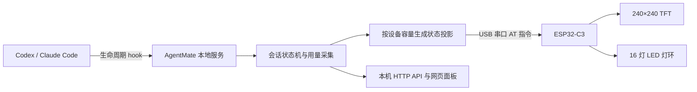

# AgentMate 产品需求文档（PRD）

文档版本：**V0.3**  
修订日期：**2026-10-01**  
产品阶段：服务端核心能力已有代码，设备通信与产品界面待实现  
目标版本：首个可日常使用的 USB 桌面设备版本

本文以当前 agentmate_service 服务端代码、[通信技术方案](agentmate_communication_plan.md)、[AT 指令指南](agentmate_at_command_guide.md) 和 [硬件连接说明](hardware_connection.md) 为依据。协议字段、错误码和交互顺序以 AT 指令指南为准。

## 1. 产品定义

AgentMate 是面向 AI 编程工具使用者的桌面硬件伴侣。电脑上的本地服务接收 Codex 与 Claude Code 的生命周期事件，维护各会话的当前状态；ESP32-C3 设备通过 USB 串口接收精简状态，以 240×240 圆形 TFT 和 16 颗 RGB LED 灯环提示“正在工作、需要处理、任务已结束”等信息。

产品的核心价值是让用户离开终端时，仍能及时发现需要自己介入的会话，并看见任务结果。首版只呈现**有可靠事件依据的状态**。服务端尚不能稳定区分一般工作过程中的“思考、编辑、运行测试”，设备不应把这些细分活动当成已识别事实。

首版使用本机服务与 USB 设备，不依赖 AgentMate 云服务。电脑上的 Agent 继续正常工作；设备断开不能影响 hook 执行或 Agent 会话。

## 2. 用户与使用场景

核心用户是同时使用 Codex 或 Claude Code、经常让任务在后台运行的开发者。主要场景：

1. **等待批准或输入**：用户离开终端后，设备明确提示哪个 provider 的哪个会话需要处理。
2. **长时间工作**：设备显示会话仍在 `working`，并能与“状态近期未更新”的 `stale` 区分。
3. **任务结束**：完成、失败和取消产生一次性提醒；提醒结束后，会话回到其真实当前状态。
4. **多个会话并行**：设备在其容量内显示多个会话，优先呈现需要用户处理的会话；电脑端面板仍可查看完整列表。
5. **用量查看**：设备在有数据时展示 Codex 账号配额，Claude 会话在有读数时展示上下文占用；不可用时显示未知，不沿用过期数值。
6. **首次配对**：新设备插入电脑后自动显示限时四位码；用户在 AgentMate 本机网页的对应设备卡片输入，成功后开始同步。设备及本机服务重启后不再要求输入码。
7. **拔插或重启**：设备和服务重新连接后恢复当前会话，不重复播报旧任务结果。

## 3. 当前实现基线

| 模块 | 当前代码已有 | 首版仍需完成 |
|---|---|---|
| 电脑服务 | Go daemon、Codex/Claude Code hook 接入、provider 适配器、内存会话状态机、进程存活检查与 stale 规则 | 设备连接管理、状态投影、设备配置入口 |
| 本机查看 | HTTP API、每两秒刷新的内嵌网页面板、Unix socket hook 通道 | 在现有本机网页完成四位码配对，查看设备在线、容量与亮度状态 |
| 用量 | Codex 账号配额采集；Claude 和部分 Codex 会话的 context 读数可在本机面板查看 | 将可用数据按设备协议投影和同步 |
| ESP32 固件 | ESP32-C3 的 16 灯 RGB 驱动、240×240 GC9A01 TFT 驱动及主程序硬件演示 | USB AT 协议、配对、会话表、时间同步、产品显示逻辑 |
| 设备协议 | 通信方案与 AT 指令指南已定义 | 固件与服务端实现、联调 |

电脑服务默认通过 `127.0.0.1:8765` 提供本机 HTTP 服务，通过独立的私有 Unix socket 接收 hook。会话状态目前只保存在内存中；已结束会话可在服务重启前继续出现在网页面板。设备通信不能改变这些本机接口和 hook 的投递方式。

## 4. 首版目标与范围

### 4.1 必须交付

- 通过 USB 串口自动发现并识别 AgentMate 设备；未与本机配对时在设备上显示限时四位码，由用户在本机网页输入。配对成功后持久认证，后续上电自动连接，并完成心跳、断线重连和时间同步。
- 将服务端会话逐条同步到设备：首次连接全量核对，后续只发送变化的会话；退出或不再入选的会话主动删除。
- 设备报告自身会话容量，服务端按优先级选择；单台服务端可独立管理多台设备，首版默认最多 4 台在线。
- 呈现 Codex 与 Claude Code 会话状态、最近任务结果和需要用户处理的提醒；支持 Claude context 占用与独立的 provider 用量记录。现有数据源中先接入 Codex 账号配额。
- 提供 TFT 背光与 LED 灯环亮度设置及查询；设置范围均为 `0–255`，写入设备 NVS 并在重启后恢复。
- 无效命令、串口拔出、服务重启和用量采集失败均不能导致固件崩溃、阻塞 Agent hook 或展示过期数据。

### 4.2 暂不纳入

- 设备直接调用大模型、语音、麦克风、蜂鸣器或物理按键交互。
- 从普通 `working` 状态推测“思考、编辑、测试”等细分阶段，以及没有可信来源的任务完成百分比。
- 在设备上显示完整提示词、工作目录、日志、代码差异或任意长文本；当前 AT 会话命令也不传这些内容。
- Wi‑Fi 连接、远程访问、OTA、设备网页配置、AgentMate 账号登录、托盘应用、历史任务持久化、跨电脑汇总和 Windows 正式安装支持。Wi‑Fi 的发现与安全要求保留在通信方案中作为后续扩展。

## 5. 硬件与系统架构

首版原型为 ESP32-C3、16 颗 WS2812B/SK6812 类 RGB LED、240×240 GC9A01 圆形 TFT 和 USB 供电/串口连接。TFT 背光通过可控 GPIO/PWM 调节；若某硬件版本将背光硬接电源，设备对背光命令报告不支持。默认亮度沿用当前驱动设置：LED `64/255`，TFT `192/255`。

服务端负责 provider 差异、事件去重、会话选择、用量采集和设备连接。固件负责协议解析、固定容量的会话表、亮度配置和呈现。设备连接与本机网页面板消费同一服务端状态，但彼此故障隔离。

## 6. 会话与提醒需求

### 6.1 会话状态

| 服务端状态 | 设备侧含义 | 呈现要求 |
|---|---|---|
| `initializing` | 已发现但尚未就绪 | 中性等待状态 |
| `ready` | 等待下一次任务 | 低干扰待机状态 |
| `working` | 收到 prompt 或工具活动，任务正在进行 | 明确的活动状态 |
| `waiting_for_input` | 上游明确报告需要用户输入 | 高优先级提醒 |
| `permission_required` | 上游明确报告需要权限批准 | 最高优先级提醒 |
| `stale` | 工作会话超过设定时间未更新 | 区分于正常工作，不推断任务失败 |
| `offline` | 保留的会话离线状态 | 区分于设备 USB 离线 |
| `ended` | 会话已结束 | 从设备会话表移除；电脑端可保留历史 |

当前服务端的 `Stop`、取消或失败事件会让会话回到 `ready`，最近一次任务结果另外保存在 `last_task`。因此设备必须把**当前状态**与**刚发生的结果提醒**分开：`EVENT` 触发短时提醒，`SESSION` 决定提醒结束后的状态。`completed`、`failed`、`cancelled` 不作为持久会话状态。迟到事件不能把已经结束的 turn 重新显示为工作中。

`waiting_for_input` 只有在上游能明确识别时才显示。一般权限提示使用 `permission_required`。Codex 的静默连接失败若没有失败事件，不应被设备自行标成 `failed`。

### 6.2 多会话选择

设备上限由握手中的 `max_sessions` 返回，服务端不写死槽数。超出容量时，服务端按“需要批准 → 等待输入 → 工作中 → stale → ready → initializing → offline”的顺序选择，同级保持稳定顺序；`ended` 不占设备槽位。新会话挤入时，先删除不再入选的旧会话，再新增目标会话。

屏幕至少能看见当前聚焦会话的 provider、状态和当前已同步会话数量。需要用户处理的会话始终优先；有多个普通会话时可自动轮换。LED 灯环的基础状态映射应与屏幕一致，不能在屏幕显示待批准时表现为普通工作中。颜色、图标和动效细节在 UI 设计阶段确定，但不同提醒必须能被清楚区分。

### 6.3 Context 与 provider 用量

- Claude 会话有 context 读数时可显示已使用 token、窗口大小和占用百分比；首次响应前或 compaction 后暂时无读数时显示“未知”。
- 当前设备协议中 Codex 会话的 context 字段为空，表示设备侧暂不支持该项；电脑端面板已有的 Codex context 能力不因此改变。
- Provider 用量由独立的 `USAGE` / `USAGECLEAR` 指令同步，字段包括 provider、指标、时间窗口、已用比例与重置时间。现有服务端的数据源为 Codex 账号配额；其他 provider 有可靠来源后才展示。
- 用量采集失败或数据不可用时清除设备旧记录。设备不得把“未知”显示为 0%，也不得把账号配额当成某个会话的 context 占用。

## 7. 连接、配置与时间需求

### 7.1 发现与连接

服务端从 USB 串口候选设备中通过 `HELLO` 响应识别协议，不仅凭 VID/PID 判断。设备使用持久 `device_id`；服务端使用持久 `server_id`。两者尚未配对时，服务端自动开启一次 120 秒窗口，设备只在屏幕显示随机四位数字和 ID 后八位。用户打开**现有本机网页面板**，在对应设备卡片输入四位码；服务端提交随机长期密钥，设备确认码正确并保存后，双方重新握手完成双向 HMAC 认证。四位码本身不作长期密钥，串口/Web 响应不返回四位码。未认证设备不能接收会话。开发调试模式需显式开启，并明确标注身份未验证。

首版一台设备只记住一台电脑。新电脑通过设备屏幕四位码配对成功后替换旧配对；输错、超时或保存失败时旧配对仍有效。单个窗口最多三次错误输入，之后冷却五分钟；窗口过期不自动反复弹出，可在网页中重试。设备或原电脑重新上电时使用已保存的密钥认证，不再要求输入码。服务端密钥记录丢失或认证失败时，在网页提供手动重新配对入口。

连接后先同步时间，再逐条同步当前会话与用量。设备对每个命令返回 `OK` 或错误；服务端可使用 `LIST?` 和 `GET` 核对设备内容。每 10 秒心跳；连续 3 次超时或串口错误使该设备离线并触发重连。设备 30 秒未收到有效命令时清除远端会话与用量，进入服务不可用状态。服务或设备重启后重新完整核对，不重复播报历史任务提醒。

多台设备各自维护连接、容量、心跳和同步进度。单台设备掉线或响应慢时，其他设备和 hook 通道继续工作。一台设备同一时间只接受一台 AgentMate 服务端控制。

### 7.2 时间与亮度

电脑系统 UTC 时间为设备时间源。认证后使用 `TIME` 命令校准，之后每 30 分钟重校；设备可通过 `TIME?` 报告当前时间、启动时长及上次校时距今多久。服务端估算偏差超过 100 毫秒时重新校时。设备重启后的时间在首次校准前视为无效；用户时区不通过协议传输。

`TFTBRIGHT` 与 `LEDBRIGHT` 分别调节屏幕背光和 LED 灯环，支持查询当前值。设置成功后立即生效并保存到 NVS。亮度为 0 时允许完全熄灭；LED 高亮度可能增加 USB 供电负载，首版默认采用当前驱动的低亮度设置。

## 8. 电脑端交互

现有服务端已提供本机网页面板与 API：`GET /v1/status`、`GET /v1/sessions`、`GET /v1/codex-usage`、`POST /v1/events`、`POST /v1/context-usage` 和 `GET /healthz`。hook 默认走私有 Unix socket；HTTP 默认只监听本机。`/v1/events` 接收 Agent 事件，不作为设备管理或配对接口。

首版应在现有本机网页提供设备卡片，显示设备 ID、固件版本、配对倒计时/错误、在线状态、会话容量、最后心跳，以及亮度设置和查询。用户可输入四位码或在窗口过期后重新请求；网页不显示设备四位码或长期密钥，不要求账号登录，也不开发独立托盘应用。配对写入接口仅接受本机回环与同源请求，不复用 `/v1/events`。页面必须能区分“服务端没有会话”“设备未连接”“设备已连接但未与本机配对”“用量不可用”。

## 9. 体验与质量要求

| 目标 | 验收口径 |
|---|---|
| 重要提醒及时可见 | 已进入服务端状态机的权限请求，在正常 USB 连接下 1 秒内被设备确认；不把 provider hook 自身延迟算进设备链路 |
| 正确区分状态 | `permission_required`、`working`、`stale`、`ready`、连接离线及任务完成/失败/取消在设备上可辨识 |
| 同步可恢复 | USB 拔插、服务端重启或 ESP32 重启后，重新握手并核对会话；设备最终集合与服务端为其选定的集合一致 |
| 容量受控 | 服务端不向设备发送超过报告槽数的会话或用量记录；容量变化后重新计算选择 |
| 提醒不重复 | 重发同一 `event_id` 只产生一次提醒；重连不重播旧完成提醒 |
| 故障隔离 | 异常 AT 行或慢设备不使固件重启，也不阻塞其他设备、hook 投递或本机 HTTP |
| 数据可信 | context 与配额未知时显示未知或清除；会话结束后主动从设备移除 |
| 配对可恢复 | 正确四位码配对后重新握手成功；断电重启不重配；提交响应丢失时可用待确认密钥恢复 |
| 错误配对受限 | 四位码可有前导零；第三次错误关闭窗口并冷却，超时后设备隐藏数字；失败不覆盖旧密钥 |

测试场景至少覆盖非 AgentMate 串口、首次四位码配对、`0042` 等前导零、输错三次、窗口超时、多台设备同时待配对、新电脑替换旧电脑、服务端提交后退出、NVS 保存失败、认证失败、超长或坏格式命令、空会话、多会话超过容量、进程退出但缺少结束 hook、Claude context 暂时未知、Codex 配额采集失败、重复事件、两端重启和长时间空闲仍保持连接。视觉效果需在真实设备上确认，不以仿真截图代替。

## 10. 版本推进

| 阶段 | 交付重点 | 退出条件 |
|---|---|---|
| 当前基线 | 本地服务状态机、hook 接入、网页面板、配额与 context 数据；ESP32 驱动演示；AT 协议文档 | 服务端数据来源与设备协议字段已对齐 |
| 通信联调 | USB 枚举、设备四位码与本机网页配对、心跳、校时、会话与用量同步、亮度配置 | 真实 ESP32 能在配对及重启、拔插后恢复一致状态 |
| 体验完成 | 圆屏信息层级、LED 提醒、设备管理入口、异常状态提示 | 用户可识别需要处理的会话及任务结果 |
| 首版试用 | 安装流程、稳定性、功耗与供电验证、用户反馈修正 | 达到第 9 节验收要求并完成日常工作流试用 |

## 11. 主要风险与约束

| 风险 | 处理原则 |
|---|---|
| Provider hook 只能报告部分活动，且异步事件可能乱序 | 沿用服务端状态机及 turn 守卫，不从沉默推断失败或工作细分阶段 |
| Codex 配额与 context 依赖本地 app-server，可暂时不可用 | 展示不可用状态并清除旧配额；会话监控继续工作 |
| 服务端会话保存在内存中 | 重启后使用新 epoch，设备清除旧会话并按当前服务端重新同步 |
| USB 开发板的 VID/PID 可能通用 | 使用协议探测与配对密钥识别设备 |
| 四位码空间有限 | 仅用于面对设备的短时确认；限制窗口与错误次数，配对后改用随机长期密钥认证 |
| 圆屏面积有限，多个会话竞争注意力 | 优先显示需要处理的会话，并由服务端按设备容量裁剪 |
| 16 灯高亮度可能超过 USB 供电余量 | 默认限制在较低亮度，按硬件连接说明验证电源与电平转换 |

## 12. 后续方向

首版验证后再评估 Wi‑Fi、OTA、跨电脑状态汇总、额外 provider、物理交互与更细粒度的工作阶段。新增状态必须有可靠数据源，并先进入服务端统一模型，再扩展设备协议与视觉设计。
