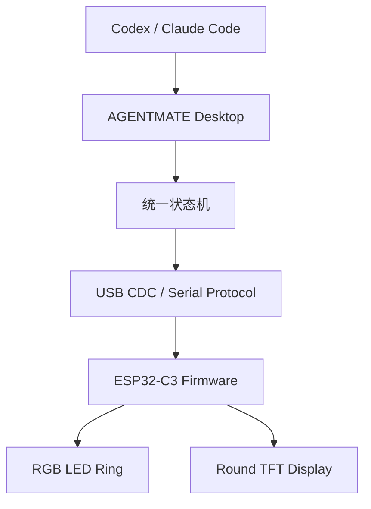

# AGENTMATE 产品需求文档 PRD

版本：V0.1  
日期：2026-09-16  
产品名称：AGENTMATE  
产品定位：AI Coding Agent 桌面硬件伴侣  

---

## 1. 产品概述

AGENTMATE 是一个面向 AI Coding Agent 使用者的桌面硬件伴侣。产品通过 USB 连接电脑，与电脑端运行的 AGENTMATE Desktop 代理软件通信，将 Codex、Claude Code 等 AI 编程 Agent 的运行状态、任务进度、等待确认、错误、完成提醒等信息，以 RGB 灯环和圆形 TFT 屏幕的方式实体化展示。

第一版产品由 ESP32-C3、16 颗 RGB LED 灯环、160x160 圆形 TFT 显示屏和桌面端代理软件组成。硬件端负责状态显示与简单交互，桌面端负责接入不同 AI Coding Agent，统一状态抽象，并通过 USB 串口协议发送给硬件。

产品核心目标不是替代桌面通知，而是让 AI Coding Agent 从“终端里的一段文本输出”变成一个可感知、可陪伴、可提醒的桌面工作伙伴。

---

## 2. 背景与机会

随着 Codex、Claude Code 等 AI Coding Agent 逐渐进入日常开发工作流，开发者与 Agent 的交互正在从单次问答变成长时间协作。Agent 会经历思考、编辑文件、运行命令、等待用户确认、测试失败、任务完成等多个状态，但这些状态通常分散在终端、IDE 或网页界面中。

当前痛点：

1. Agent 运行过程缺少外部可见状态，用户离开终端后不容易知道任务是否卡住。
2. Agent 等待确认、命令执行完成、测试失败等事件容易被忽略。
3. 多个 Agent 或多个任务并行时，状态感知混乱。
4. AI Coding Agent 缺少实体化陪伴感，长期使用时体验偏工具化。
5. 桌面开发环境中缺少一个低打扰、高辨识度的 Agent 状态中枢。

AGENTMATE 通过硬件外设和桌面代理软件，把 Agent 状态转化为灯效、图标、表情和短文本提醒，提升开发者对 Agent 工作状态的感知效率。

---

## 3. 产品目标

### 3.1 V1 目标

V1 聚焦于“AI Coding Agent 状态显示器”：

1. 支持通过 USB 连接电脑。
2. 支持 AGENTMATE Desktop 向硬件发送统一状态事件。
3. 支持 Codex 和 Claude Code 两类 Agent 的基础状态映射。
4. 使用 RGB LED 灯环展示状态氛围和进度。
5. 使用圆形 TFT 屏幕展示 Agent 名称、状态、简短消息和图标。
6. 支持等待用户确认、任务完成、错误失败等关键提醒。
7. 提供简单的配置能力，例如亮度、主题、Agent 类型。

### 3.2 非目标

V1 暂不追求：

1. 硬件端直接调用大模型。
2. 复杂语音交互。
3. 屏幕显示长文本、完整代码 diff 或完整日志。
4. 同时管理大量 Agent 任务。
5. 作为通用通知屏幕替代品。
6. 脱离电脑独立运行。

---

## 4. 目标用户

### 4.1 核心用户

使用 Codex、Claude Code、Cursor Agent、Aider 等 AI 编程工具的开发者。

典型特征：

1. 经常让 Agent 执行多步骤编码任务。
2. 同时关注代码编辑、命令执行、测试结果和人工确认。
3. 希望减少盯着终端等待的时间。
4. 对桌面硬件、机械键盘、电子 DIY 或开发者效率工具有兴趣。
5. 愿意为有趣且实用的开发者外设付费。

### 4.2 次级用户

1. AI 工具重度用户。
2. 嵌入式、机器人、开源硬件爱好者。
3. 直播、视频创作者，用于展示 AI Agent 工作状态。
4. 团队研发负责人，用于演示 AI Coding 工作流。

---

## 5. 用户场景

### 5.1 Agent 正在思考

用户向 Codex 提交一个任务后，AGENTMATE 灯环以蓝色旋转动画显示“Thinking”，屏幕显示当前 Agent 名称和思考状态。用户可以离开终端做其他事情，不需要持续盯着屏幕。

### 5.2 Agent 正在修改代码

当 Agent 进入编辑文件阶段，灯环切换为绿色流动效果，屏幕显示“Editing files”。用户可以一眼知道 Agent 仍在工作。

### 5.3 Agent 等待用户确认

当 Agent 需要用户批准命令、确认文件修改或提供输入时，灯环以橙色脉冲提醒，屏幕显示“Need approval”。这是 V1 最重要的提醒场景之一。

### 5.4 命令执行中

当 Agent 正在运行构建、测试、安装依赖等命令时，灯环显示黄色扫描效果，屏幕显示命令类型或简短状态，例如“Running tests”。

### 5.5 任务完成

当任务成功完成时，灯环播放绿色扩散动画，屏幕显示“Done”。几秒后进入待机状态。

### 5.6 任务失败

当测试失败、命令执行失败或 Agent 报错时，灯环显示红色闪烁，屏幕显示“Failed”及简短原因。

### 5.7 多 Agent 切换

用户同时使用 Codex 和 Claude Code 时，桌面端可以选择当前活跃 Agent。硬件通过主题色、图标或名称区分当前状态来源。

---

## 6. 产品形态

### 6.1 硬件形态

桌面小型圆形设备，正面为 RGB LED 灯环，中间嵌入 160x160 圆形 TFT 显示屏。通过 USB-C 接入电脑并供电。

建议硬件组成：

| 模块 | 建议方案 | 说明 |
|---|---|---|
| 主控 | ESP32-C3 | 支持 USB CDC，性能满足显示与灯效 |
| 显示屏 | 160x160 圆形 TFT | 推荐 GC9A01 或 ST7789 驱动 |
| 灯环 | 16 颗 WS2812B 或 SK6812 | 单线控制，适合状态灯效 |
| 连接 | USB-C | 供电 + 通信 |
| 供电 | USB 5V | LED 走 5V，MCU 走 3.3V |
| 外壳 | 3D 打印或注塑 | 第一版建议 3D 打印验证 |

### 6.2 软件形态

产品包含两部分软件：

1. AGENTMATE Firmware：运行在 ESP32-C3 上，负责 USB 通信、TFT 显示、LED 动画和设备配置。
2. AGENTMATE Desktop：运行在电脑上，负责接入 Codex、Claude Code 等 Agent，解析状态，统一协议，并发送给硬件。

---

## 7. 系统架构



### 7.1 设计原则

1. 桌面端负责复杂逻辑，硬件端负责显示渲染。
2. Agent 接入层与硬件协议解耦。
3. 硬件协议保持简单，优先使用 JSON Lines。
4. V1 不依赖云服务。
5. 所有关键状态必须能在离线环境下工作。

---

## 8. 核心功能需求

### 8.1 Agent 状态显示

硬件应支持以下基础状态：

| 状态 | 含义 | LED 效果 | 屏幕显示 |
|---|---|---|---|
| idle | 空闲 | 低亮度白色呼吸 | Agent 头像或待机 |
| thinking | 思考中 | 蓝色旋转 | Thinking |
| planning | 规划中 | 蓝紫色缓慢旋转 | Planning |
| editing | 修改代码 | 绿色流动 | Editing files |
| running | 执行命令 | 黄色扫描 | Running |
| testing | 测试中 | 黄色环形进度 | Running tests |
| waiting | 等待用户 | 橙色脉冲 | Need approval |
| blocked | 被阻塞 | 紫色慢闪 | Blocked |
| success | 完成 | 绿色扩散 | Done |
| error | 错误 | 红色闪烁 | Failed |

### 8.2 简短消息显示

桌面端可以向硬件发送一条短消息，屏幕显示 1 到 2 行内容。

要求：

1. 单条消息建议不超过 32 个英文字符或 12 个中文字符。
2. 超出长度时由桌面端截断。
3. 硬件端不负责复杂排版。
4. 消息显示应有超时机制。

### 8.3 进度显示

硬件支持显示 0% 到 100% 的进度，用于任务执行、测试运行或文件处理。

显示方式：

1. LED 灯环按比例点亮。
2. 屏幕中间显示百分比。
3. 若无确定进度，则使用不确定动画。

### 8.4 Agent 身份显示

设备应能显示当前 Agent：

1. Codex
2. Claude
3. Custom Agent

每个 Agent 可配置：

1. 名称
2. 主题色
3. 头像或图标
4. 默认待机动画

### 8.5 设备配置

V1 支持通过桌面端配置：

1. LED 亮度。
2. 屏幕亮度。
3. 默认 Agent。
4. 状态提醒强度。
5. 是否启用声音提醒，若硬件后续增加蜂鸣器。
6. 是否启用夜间低亮度模式。

### 8.6 连接状态

桌面端应显示设备连接状态：

1. 未连接。
2. 已连接。
3. 连接异常。
4. 固件版本。
5. 设备序列号，V1 可选。

硬件端在未连接桌面端时，应进入低亮度待机状态。

---

## 9. 桌面端需求

### 9.1 基础能力

AGENTMATE Desktop 负责：

1. 识别 USB 串口设备。
2. 与硬件建立连接并维持心跳。
3. 接收或解析 Agent 状态。
4. 映射为统一状态事件。
5. 发送状态事件到硬件。
6. 提供配置界面。
7. 提供日志查看与调试模式。

### 9.2 Agent 接入方式

V1 可以支持三种接入方式：

| 接入方式 | 优先级 | 说明 |
|---|---:|---|
| 手动 API / 本地事件 | 高 | AGENTMATE Desktop 提供本地 HTTP/WebSocket 接口，外部工具主动上报状态 |
| CLI 输出解析 | 中 | 解析 Codex 或 Claude Code 的终端输出，快速验证体验 |
| 插件式适配器 | 中 | 为不同 Agent 编写 adapter |

建议 V1 先实现“本地事件接口 + 手动模拟器”，再逐步增加 Codex/Claude 的真实适配器。

### 9.3 本地接口

桌面端可提供本地接口：

```text
POST http://127.0.0.1:8765/api/event
```

示例：

```json
{
  "agent": "codex",
  "type": "state",
  "state": "thinking",
  "message": "Analyzing repo"
}
```

### 9.4 托盘应用

V1 桌面端建议做成托盘应用：

1. 显示设备连接状态。
2. 显示当前 Agent 状态。
3. 支持亮度调节。
4. 支持测试灯效。
5. 支持选择 Agent 主题。
6. 支持查看最近事件。

---

## 10. 固件需求

### 10.1 固件职责

ESP32-C3 固件负责：

1. 初始化 TFT 显示屏。
2. 初始化 RGB LED 灯环。
3. 通过 USB CDC 接收状态消息。
4. 解析 JSON Lines 协议。
5. 根据状态执行 LED 动画。
6. 根据状态更新屏幕 UI。
7. 响应桌面端心跳。
8. 保存基础配置。

### 10.2 固件模块划分

建议模块：

| 模块 | 职责 |
|---|---|
| usb_comm | USB CDC 收发 |
| protocol | JSON Lines 解析与校验 |
| led_engine | LED 动画渲染 |
| display_ui | TFT UI 渲染 |
| state_machine | 设备状态机 |
| config | 配置保存 |
| diagnostics | 调试与版本信息 |

### 10.3 固件性能要求

1. LED 动画刷新率不低于 30 FPS。
2. 屏幕状态切换延迟小于 200 ms。
3. USB 消息响应延迟小于 100 ms。
4. 异常消息不得导致设备重启。
5. 断开连接后应自动回到待机状态。

---

## 11. 通信协议草案

### 11.1 协议形式

V1 使用 USB CDC 串口，消息格式采用 JSON Lines：

```text
{"type":"state","agent":"codex","state":"thinking","message":"Analyzing repo"}\n
```

每一行是一条完整 JSON 消息。

### 11.2 消息类型

#### state

用于切换 Agent 状态。

```json
{
  "type": "state",
  "agent": "codex",
  "state": "editing",
  "message": "Editing files"
}
```

#### progress

用于显示进度。

```json
{
  "type": "progress",
  "agent": "codex",
  "value": 0.65,
  "message": "Running tests"
}
```

#### notify

用于短提醒。

```json
{
  "type": "notify",
  "level": "warning",
  "message": "Need approval"
}
```

#### config

用于配置设备。

```json
{
  "type": "config",
  "led_brightness": 0.35,
  "display_brightness": 0.8,
  "theme": "codex"
}
```

#### ping

用于心跳。

```json
{
  "type": "ping",
  "timestamp": 1799971200
}
```

设备返回：

```json
{
  "type": "pong",
  "firmware": "0.1.0",
  "uptime": 12345
}
```

### 11.3 错误处理

硬件端收到无法解析的消息时：

1. 不应重启。
2. 应丢弃该消息。
3. 可返回错误信息。

```json
{
  "type": "error",
  "code": "invalid_json",
  "message": "Invalid JSON line"
}
```

---

## 12. UI 与视觉需求

### 12.1 屏幕 UI

160x160 屏幕不适合显示复杂信息。V1 屏幕只显示：

1. Agent 名称。
2. 当前状态。
3. 简短消息。
4. 进度百分比。
5. 简单图标或头像。

推荐布局：

1. 顶部：Agent 名称。
2. 中心：状态图标或表情。
3. 底部：状态文字或短消息。

### 12.2 LED 动画

LED 灯环负责提供远距离可见状态。

设计原则：

1. 状态颜色必须稳定，用户形成记忆。
2. 关键状态需要明显区分，例如 waiting 和 error。
3. 夜间模式降低亮度和动画频率。
4. 避免长时间高频闪烁，减少干扰。

### 12.3 Agent 主题

建议默认主题：

| Agent | 主色 | 风格 |
|---|---|---|
| Codex | 蓝色 / 青色 | 冷静、工程感 |
| Claude | 橙色 / 暖白 | 温和、陪伴感 |
| Custom | 用户自定义 | 可扩展 |

---

## 13. MVP 范围

### 13.1 MVP 必须包含

1. ESP32-C3 固件基础框架。
2. RGB LED 灯环驱动。
3. TFT 屏幕驱动。
4. USB CDC 串口通信。
5. JSON Lines 协议解析。
6. 10 个基础状态显示。
7. 桌面端设备连接。
8. 桌面端手动状态模拟器。
9. 本地 HTTP 接口接收状态事件。
10. 基础配置：亮度、主题、Agent 名称。

### 13.2 MVP 可以暂缓

1. 正式量产外壳。
2. 自动识别所有 Agent 状态。
3. 复杂动画编辑器。
4. 多设备支持。
5. 远程通知。
6. 固件 OTA。
7. 麦克风、扬声器、触摸输入。

---

## 14. 版本规划

### V0.1 原型验证

目标：验证硬件显示与桌面端通信。

交付：

1. ESP32-C3 驱动 LED 和 TFT。
2. USB 串口接收 JSON。
3. Python 或 Node.js 脚本发送模拟状态。
4. 3D 打印简易外壳。

### V0.2 桌面端 MVP

目标：形成可日常使用的桌面代理软件。

交付：

1. 托盘应用。
2. 设备自动连接。
3. 本地 HTTP API。
4. 状态模拟器。
5. Codex/Claude 基础状态适配。

### V0.3 体验打磨

目标：提升陪伴感与可靠性。

交付：

1. Agent 主题系统。
2. 更完整的灯效库。
3. 任务历史。
4. 等待确认提醒优化。
5. 错误和完成提醒优化。

### V1.0 小批量试用

目标：面向开发者小范围试用。

交付：

1. 稳定固件。
2. 完整桌面端安装包。
3. 统一协议文档。
4. 结构优化外壳。
5. 用户反馈收集机制。

---

## 15. 成功指标

### 15.1 产品体验指标

1. 用户能在 3 秒内判断 Agent 当前状态。
2. 等待用户确认的状态不容易被错过。
3. 设备连接稳定，日常使用无需频繁重启。
4. 灯效不干扰正常办公。
5. 用户愿意把设备长期放在桌面上。

### 15.2 技术指标

1. USB 断线重连成功率大于 99%。
2. 状态消息到显示更新延迟小于 300 ms。
3. 连续运行 24 小时无异常重启。
4. 固件异常消息处理不崩溃。
5. 桌面端 CPU 占用低于 3%，空闲时低于 1%。

---

## 16. 风险与应对

| 风险 | 影响 | 应对 |
|---|---|---|
| Codex/Claude 没有稳定事件接口 | 状态适配困难 | 优先提供本地 HTTP API 和手动适配器，CLI 解析作为补充 |
| CLI 输出格式变化 | 适配容易失效 | 将 adapter 做成插件化，降低维护成本 |
| 屏幕太小 | 信息显示受限 | 只显示状态和短消息，不显示长文本 |
| LED 过亮或干扰 | 影响办公体验 | 提供亮度限制和夜间模式 |
| USB 连接不稳定 | 体验变差 | 增加心跳、自动重连、状态降级 |
| 产品变成玩具 | 商业价值不足 | 聚焦等待确认、完成提醒、错误提醒等高价值场景 |
| 多平台桌面端开发成本高 | 进度变慢 | 第一版优先 macOS 或 Windows，后续扩展 |

---

## 17. 商业化方向

### 17.1 开源硬件路线

适合早期获取开发者用户：

1. 开源固件。
2. 开源桌面端。
3. 提供 3D 打印外壳文件。
4. 销售套件或 PCB。

### 17.2 成品硬件路线

适合形成小众产品：

1. 销售完整桌面硬件。
2. 提供跨平台桌面软件。
3. 支持主流 Agent 工具。
4. 形成开发者桌搭产品。

### 17.3 软件平台路线

长期可扩展为 Agent 状态中枢：

1. 管理多个 AI Agent。
2. 支持桌面通知、硬件通知、手机通知。
3. 支持插件市场。
4. 支持团队状态看板。

---

## 18. 开放问题

1. 第一版优先支持 macOS、Windows 还是 Linux？
2. Codex 和 Claude Code 的状态接入方式是否能找到稳定事件源？
3. 是否需要增加物理按键，用于确认、静音或切换 Agent？
4. 是否需要蜂鸣器或震动马达？
5. 是否要支持多个任务队列？
6. 设备外观应偏科技感、可爱陪伴感，还是开发者工具感？
7. 是否需要从 V1 开始支持固件 OTA？

---

## 19. 建议的下一步

建议按以下顺序推进：

1. 明确第一版目标平台，例如先支持 macOS 或 Windows。
2. 购买 ESP32-C3 开发板、16 位 RGB LED 灯环、160x160 圆形 TFT。
3. 先用脚本通过 USB 串口发送 JSON，验证硬件显示效果。
4. 定义第一版状态机和灯效规范。
5. 开发 AGENTMATE Desktop 最小版本。
6. 制作 3D 打印外壳。
7. 用真实 Codex/Claude 工作流试用一周，记录状态映射是否有价值。

---

## 20. 一句话定义

AGENTMATE 是一个把 AI Coding Agent 的工作状态实体化的桌面硬件伴侣，让开发者不用盯着终端，也能感知 Agent 正在思考、编码、等待、失败或完成。
