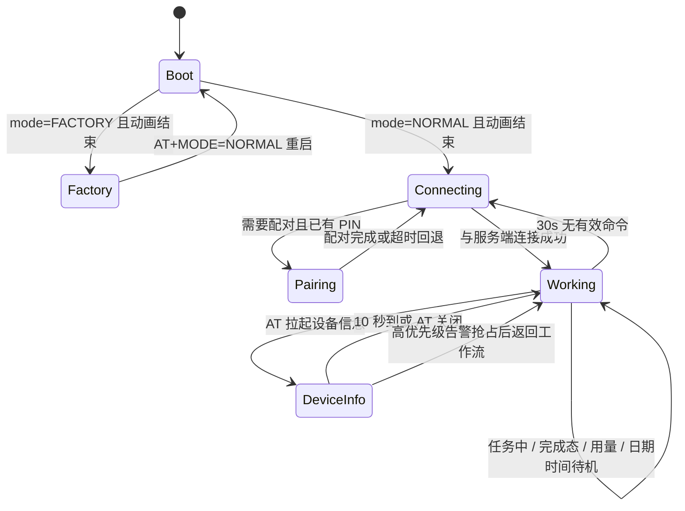

# AgentMate 圆形屏 UI 设计需求

文档版本：**1.19**<br>
修订日期：**2026-10-12**<br>
状态：供 UI 设计稿与动效交付；固件实现以定稿后的标注与素材为准  
读者：UI 设计师（主）、固件开发、产品验收

本文描述 ESP32-C3 设备上 240×240 圆形 TFT 与 16 颗 RGB 灯环的目标界面。字段语义与连接流程以 [AT 指令指南](agentmate_at_command_guide.md) 为准；硬件边界以 [硬件连接说明](hardware_connection.md) 为准。第 8、12 节的页面选择规则替代软件设计文档 7.1 节的旧轮播方案，一期固件已按本版实现，验收记录见 agentmate_ui_implementation.md。当前固件为自绘实现。是否引入 LVGL 的结论见第 18 节：**本期不引入**。下文的内存与刷新约束对自绘和任何后续图形库同样有效。

---

## 当前定稿：固件 v2.0／视觉稿 v6.3

以 [全页面设计稿](design/session_page_five_rows.html) v6.3 为当前视觉依据；以下定稿覆盖本文旧版中同项布局、字号与背景要求，未涉及的行为继续按原规则执行。

- 所有页面默认纯黑，产测纯色检查除外。非 Session 连接顶栏高 39 px，底角为 96×39 px 椭圆，中央直线位置不变。
- Session 黑色头部采用 agent 色的 2 px 弧形下边框；顶部时间为圆润 24 px 字体，目录单行、无图标、无独立底色，使用 agent 代表色。C3 目录仅显示可打印 ASCII，其余字符逐个替换为 `?`。
- 左侧 38 px agent 图标直接融入黑底；右侧主状态保留黑底、彩色文字及现有边框动效。工作时长采用方正数字，常规 32 px，长时长自适应缩小。
- Session 明细轮换为时长 10 秒 → 有效 agent 用量 3 秒 → 有效上下文 3 秒；无效项不参加。5H／WEEK 单面板保持 67×42 px，双面板左右排列；紫色 agent 面板与蓝色 CTX 面板区分。token 数值右对齐，支持 K／M，右侧两行等高并使用深浅背景。
- 时间日期待机页默认采用 B 版暖琥珀：时间 #F1BC74、日期 #D3DFDD、年份 #938573；支持 AMBER／WHITE／MINT／CODEX 四种方案，通过 AT+CLOCKTHEME 设置并持久保存。仅调整本页配色，连接顶栏与其他页面保持原色，未知值保持灰色占位；服务端配置功能暂不实现。
- 待机时间使用 52 px 方正数字，年份 20 px、月日 36 px；待机 Codex 用量保留原内容，使用 88×110 px 卡片，标题与主体背景有差异，单窗口居中并保持宽度。
- 启动、连接、信息与产测按新稿实现；产测保留实际 RGB／亮度、5 档字体与 ASCII 翻页诊断，自动测试流程不变。配对认证仍为二期。

实现与验证记录见 [UI 实施与验收记录](agentmate_ui_implementation.md)。

## 1. 目标与范围

### 1.1 产品目标

AgentMate 是放在桌面上的 AI 编程伴侣。电脑端服务把 Codex / Claude Code 的会话状态通过 USB 串口推到设备；设备用圆形屏和灯环告诉用户：

1. 哪个会话正在工作；
2. 哪个会话需要批准或输入；
3. 任务刚结束（完成 / 失败 / 取消）；
4. 最近活动 Codex 的 5 小时与一周用量；没有可展示任务或 Codex 用量时，显示主机本地日期时间待机页；设备信息由 AT 单独拉起。

用户**不会触摸或按压设备**。一期硬件没有按键、触摸屏和编码器。所有页面切换只来自：时间轮播、连接状态变化、告警抢占、产测命令，或 AT 指令拉起。

### 1.2 本期设计范围

| 页面 | 一期是否必须出稿 | 说明 |
|---|---|---|
| 启动动画 | 必须 | 上电品牌页，显示软件版本；最短 2 秒、最长 5 秒后进入连接页 |
| 设备信息页 | 必须 | 由 AT 拉起，默认 10 秒后自动关闭；单页展示，含当前日期时间 |
| 连接状态页 | 必须 | 等待主机、握手、同步中、未配对。不展示校时状态 |
| 工作页 | 必须 | 任务中 Session、完成态 Session、Codex 用量、主机本地日期时间待机页按第 8 节择一显示 |
| 配对页 | 必须出稿 | **二期功能**，一期不启用；设计稿先交付 |
| 产测页 | 必须 | 工厂测试画面与自动轮播 |

文案以**中文为主**；数字、时钟、`provider` 名称（`codex` / `claude`）、会话短键、设备 ID 十六进制、软件版本号保持英文或原样。

### 1.3 不在本期设计范围

- 完整提示词、工作目录全路径、代码差异、日志等长文本；Session 页只预留工程目录名；
- 从 `working` 臆造“思考 / 编辑 / 测试”细分阶段或虚假进度百分比；
- 需要用户点击、滑动、长按的任何控件；
- Wi‑Fi、云端、账号登录等界面；
- 在连接页、页眉或页脚展示时间同步进度、校时成功或失败；
- 任务中或完成态 Session 显示期间插入用量页（若以后需要，另开设计）。

---

## 2. 硬件与渲染硬约束

设计稿若违反本节，开发无法按像素还原。

### 2.1 屏幕与可视区

| 项目 | 约束 |
|---|---|
| 尺寸 | 1.09寸, 显示像素较小，视距约50cm-60cm，session状态页需考虑整体效果，其他页面不要求 |
| 分辨率 | 240 × 240 像素，**圆形物理屏**（GC9A01） |
| 色深 | RGB565（红/蓝 5 bit，绿 6 bit）。标注请给 RGB888，开发会转换 |
| 安全内容区 | 关键文字与图标必须落在**直径 216 px 的同心圆**内（相对屏幕中心）。外圈约 12 px 为圆角裁切安全带，仅可放弱装饰或纯色背景 |
| 四角 | 物理上不可见，禁止放置信息 |
| 旋转 | 支持 0° / 90° / 180° / 270°（`AT+TFTROTATE`）。布局须**中心对称**；旋转后不重排、不改字号。旋转角是安装参数，不在任何业务页展示 |

建议在每张设计稿上叠加直径 216 的安全圆参考线。

### 2.2 内存与刷新预算

芯片无 PSRAM，可用 heap 约 200–280 KB。当前实现按行/块局部刷新，不保留全屏 RGB565 帧缓冲（115 200 字节）。

| 项目 | 约束 |
|---|---|
| 帧缓冲 | **禁止**全屏 RGB565 缓冲 |
| 局部刷新 | 文字、图标、header 图标分块重绘；秒级数字只脏对应块 |
| 全屏动效 | 预算约 12–15 fps；启动动画、整屏转场按此设计 |
| 禁止项 | 大面积缓慢渐变（banding + 带宽）、多层半透明叠色、全屏每帧重绘的粒子海 |

### 2.3 交互输入

- **无触摸、无按键、无旋钮**。
- 设计稿中不得出现按钮、滑块、点击热区、手势示意。
- 页码、状态文案、日期时间是只读信息，不是可操作控件。

### 2.4 字体与中文

ESP32-C3 的工程目录名仅显示可打印 ASCII；非 ASCII 字符可隐藏或逐字符以 `?` 替代，当前固件采用后者。固定中文状态及其他固定文案仍按子集字模显示，不为动态目录内置完整中文字符集。Session 主状态保持纯黑背景，仅显示文字与原有边框动效。

| 字号档位（建议） | 用途 | 最小可读 |
|---|---|---|
| 24 px | 配对码、主状态词 | 中文 ≥ 16 px；英文数字 ≥ 12 px |
| 20–26 px | 会话状态、任务时长、用量百分比 | 同上 |
| 16 px | 次要说明、设备 ID、版本号、日期时间 | 同上 |
| 11–14 px | Codex 两档标签、重置时间与 Session Context 的小字 | 仅这些辅助文案允许；设计稿须做 240×240 @1x 真机可读性验证并交付对应点阵字形 |

中文主体使用现有 `hzk16` 分区，或按**文案白名单**生成的点阵子集。辅助小字若采用 11–14 px，落地前须补该字号的点阵字形，不可简单缩小 `hzk16` 后假定可读。**文案一旦新增汉字就必须重新出字库**，因此设计师必须提交完整字表（见第 13 节）。本期不依赖 LVGL 字体引擎。

### 2.5 灯环

- 16 颗 RGB LED，围成圆环，与屏幕内容独立绘制。
- 全局亮度建议常驻 20%–40%（USB 供电电流预算）；全白 100% 接近 1 A，设计勿默认满亮。
- 颜色、动效、优先级和例外见第 11 节。各页面不重复定义灯效。

### 2.6 现有素材基线

当前 provider 图标为 48×48 RGB565（`codex` / `claude`）。Session 新版式按 36×36 px 显示，仍须从原图标生成适合固件的缩放素材并保证落在安全圆内。Session 页面参考图为 [`assets/session_status.png`](../assets/session_status.png)，时间数字造型参考为 [`assets/time_number_style.svg`](../assets/time_number_style.svg)。

---

## 3. 全局页面状态机



| 顶层状态 | 对应页面 | 备注 |
|---|---|---|
| Boot | 启动动画 | 最短 2 秒、最长 5 秒，结束目标始终是连接页（产测模式则为产测页） |
| Connecting | 连接状态页 | WAIT_HOST / HANDSHAKE / SYNCING / UNPAIRED。校时不作为子状态 |
| Pairing | 配对页 | 二期；一期固件不进入 |
| Working | 工作页 | 按等待、完成、工作、待机选择；待机支持用量时每 10 秒轮播用量与日期时间 |
| DeviceInfo | 设备信息页 | 临时页，默认 10 秒，不显示倒计时，不影响灯环 |
| Factory | 产测页组 | 与正常模式互斥 |

**相对旧实现的调整（需求层）**：

- 在线不把 Session、用量与待机页串成固定轮播。按第 8.2 节选出最高优先级的单一页面集合。
- 原「设备状态页」并入设备信息页，由 AT 拉起，不进入自动轮播。
- 屏上不为校时单列状态。时间读数显示在待机页和设备信息页，不额外绘制校时角标。

### 3.1 全局固定 Header

正常模式的连接页、工作页、设备信息页、配对页，在屏幕上方共用一条固定 header。启动动画和产测页是全屏画面，不使用该 header。

| 项目 | 要求 |
|---|---|
| 位置 | 安全圆顶部居中。圆形屏顶部可用宽度很窄，header 只放一枚小图标，不放文字、不放时钟 |
| 内容 | 连接图标，只表示是否已与 AgentMate 服务端连接成功 |
| 已连接 | 业务通道可用（同步完成，正在接收会话、用量或心跳） |
| 未连接 | 等待主机、握手未完成、同步未完成、30 秒无有效命令回退、配对尚未完成 |
| 不表达 | 校时、会话忙闲、用量高低、告警级别。这些仍由页面主体和灯环表达 |

页脚**不显示时间**，也不再保留页脚时钟占位。日期时间只出现在待机页和设备信息页的主体中。

---

## 4. 页面规格模板说明

以下各页均按同一结构描述：

1. 用途  
2. 进入 / 退出条件  
3. 信息层级（主 / 次 / 辅）  
4. 数据字段表  
5. 空值与异常表现  
6. 更新频率  
7. 变化动效  
8. 灯环联动（只引用第 11 节）  

字段表中的「来源」指固件模型或 AT 字段，便于开发对照实现。除启动页和产测页外，各页默认带第 3.1 节 header，字段表不再重复列出。灯环效果只在第 11 节定义。

---

## 5. 启动动画页（Boot）

### 5.1 用途

上电后建立品牌识别，并告知当前软件版本。遮盖驱动初始化到连接页之间的空白。

### 5.2 进入 / 退出

| 条件 | 行为 |
|---|---|
| 进入 | 正常模式或产测模式上电，显示子系统就绪后立即播放 |
| 最短时长 | **2 秒**。未满 2 秒不得切走，即使连接页已经可以进入 |
| 提前结束 | 启动连接已准备好（显示可出画，协议任务已在监听串口，连接页可以接管），**且动画已显示满 2 秒**，立即进入连接页 |
| 正常结束 | 若一直未满足提前结束条件，动画播满 **5 秒**后进入连接页 |
| 结束目标 | 正常模式一律进入连接页。已经与主机连通时，也不从启动页直接跳进工作页 |
| 产测模式 | 同样遵守 2 秒 / 5 秒。结束后进入产测页，不进入连接页 |
| 禁止 | 不得为动画人为阻塞 AT 协议任务或串口发现；不得为了播完 5 秒而在连接已就绪后继续空等 |

### 5.3 信息层级

| 层级 | 内容 |
|---|---|
| 主 | 品牌标识（AgentMate 图形标或字标） |
| 次 | 软件版本号 |
| 辅 | 可选产品型号 `AGM-C3`。无 slogan 要求，无 header，无页脚时钟 |

### 5.4 数据字段

启动阶段不绑定会话 / 用量字段。

| 字段 | 示例 | 是否必须 |
|---|---|---|
| 品牌名 | AgentMate | 必须出现其一（图形或文字） |
| 软件版本 | `v1.0` | 必须。来自构建期 `AM_SOFTWARE_VERSION` |
| 型号 | AGM-C3 | 可选 |

版本号使用与设备信息页相同的字符串，避免两处格式不一致。

### 5.5 空值与异常

驱动失败时允许黑屏或纯色；不要求在启动动画上显示错误码（错误走 `+LOG:`）。版本号缺失时显示 `-`，不阻塞进入连接页。

### 5.6 更新频率

按动效时序表播放。版本号为静态文本，不随业务模型刷新。

### 5.7 变化动效

- 交付逐帧 PNG 序列 + 时序表（每帧时长、是否循环、可提前结束点）。
- 时序表必须标出 **2.0 s** 和 **5.0 s** 两个时间点。2.0 s 之后的帧可以被连接页打断；5.0 s 为最晚切页点。
- 建议前 200–400 ms 淡入 Logo，版本号随 Logo 稳定后出现，末段可淡出到连接页背景。
- 全屏动效按 12–15 fps 设计帧数（5 s × 12 fps ≈ 60 帧）。若中段可循环，循环段单独标注，避免无意义地堆满 60 张不同画面。
- 避免按 60 fps 出素材。

### 5.8 灯环联动

见第 11 节。本页不单独定义灯效。

---

## 6. 设备信息页（Device Info）

### 6.1 用途

人工核对设备身份、软件与协议版本、当前日期时间、屏幕与灯环亮度。面向装机、售后与调试，不参与日常工作轮播。校时是否成功，看本页日期时间是否正常，不另设校时行。

### 6.2 进入 / 退出

| 条件 | 行为 |
|---|---|
| 进入 | 正常模式下收到拉起指令（建议 `AT+SHOWINFO=<seconds>`，见第 15 节） |
| 默认驻留 | **10 秒**后自动关闭，回到进入前的工作页或连接页 |
| 倒计时 | **不显示**剩余秒数，不留倒计时占位 |
| 提前关闭 | `AT+SHOWINFO=0` 或等价关闭命令 |
| 告警抢占 | 驻留期间若出现 `permission_required` / `waiting_for_input` 会话抢占或有效 `AT+EVENT` 告警，**立即退出设备信息页**，优先显示对应工作页；告警结束后不自动回到设备信息页 |
| 产测模式 | 本页不可用（产测只接受产测相关命令） |
| 灯环 | 进入、刷新和退出都不改写灯环，见第 11 节 |

### 6.3 信息层级

必须排进**同一屏**。禁止拆成上下两屏或第二页。

| 层级 | 内容 |
|---|---|
| 主 | 设备 ID、型号、软件版本、协议版本 |
| 次 | 当前日期、当前时间 |
| 辅 | 屏幕亮度、灯环亮度 |

页面主体仅显示下表的 **8 行**，顺序固定为设备身份 4 行、亮度 2 行、**最下方日期与时间 2 行**。首行从屏幕 `y=51 px` 开始，与 `39 px` 高的 header 保留 `12 px` 间距；行距为 `19 px`。日期与时间仍按此顺序相邻显示，在亮度行之后留 `5 px` 分组间距。以屏幕 `x=120 px` 为竖向中心线：左列标签**右对齐**，右列值**左对齐**；标签右缘与值左缘分别距中心线至少 `7 px`，中缝至少 `14 px`。每一行的标签和值须共享文字基线，不因字体或字重不同而上下错位。信息行整体在圆屏安全区内居中，不绘制中心线。

两列保持一致的边界和行距；最长的「屏幕亮度」标签与日期值均须完整显示。不得压缩字号到低于第 2.4 节的可读下限，也不得增加第二页。

### 6.4 数据字段表

| 屏上标签 | 数据 | 来源 | 格式与样例 |
|---|---|---|---|
| 设备 ID | `device_id` 后 8 位 | `am_app_t.device_id` | 小写 hex，`dc194fa2` |
| 型号 | `AGM-C3` | `AM_PRODUCT_MODEL` | 固定 |
| 软件版本 | `software_version` | 构建 VERSION | `v1.0` |
| 协议版本 | `protocol_version` | 固定 `1` | `1` |
| 屏幕亮度 | `tft_brightness` | NVS / 运行时 | `90%` |
| 灯环亮度 | `led_brightness` | NVS / 运行时 | `40%` |
| 日期 | 服务端主机本地日历日 | Unix 时钟 + 最近同步的 UTC 偏移 | `2026-06-13` |
| 时间 | 服务端主机本地时分秒 | Unix 时钟 + 最近同步的 UTC 偏移 | `22:00:02` |

亮度原始值为 `0–255`，屏上显示 `round(value × 100 / 255)` 得到的整数百分比，限制在 `0–100%`。上表 `90%` / `40%` 是视觉稿示例值，不代表设备默认值。

不展示：会话/用量容量、uptime、剩余秒数、旋转角、`clock_valid`、校时年龄、「已同步 / 未校时」。完整 32 位设备 ID 不在本页展开。

日期时间显示服务端所在主机的本地时间，屏上不出现 `UTC`。服务端校时须同时下发 Unix 毫秒和主机当前 UTC 偏移分钟（含夏令时），设备保留 Unix 时钟，仅在日期时间排版时加偏移；不得把本地时间写成 Unix 时间。Codex 未来重置时刻须使用该时刻在主机时区生效的偏移，见第 15.3 节。现有 `AT+TIME=<unix_ms>` 尚未传偏移。

### 6.5 空值与异常

| 情况 | 表现 |
|---|---|
| 时钟尚未设置、偏移尚未同步或读数明显不合理 | 与待机页一致，显示 `---- -- --` / `--:--:--` 占位，不追加「未校时」 |
| 亮度查询失败 | 显示 `-`，不崩溃 |
| 字段放不下 | 保持 8 行与中心线双列规则；调整列宽或整体位置，不允许截断字段或增加第二屏 |

### 6.6 更新频率

- 时间：每 1 秒刷新时间块；日期跨日时再刷新日期块。
- 屏幕与灯环亮度：仅在对应值变化时刷新。
- 不轮询 AT；字段来自设备本地状态。

### 6.7 变化动效

- 进入：短促淡入（≤ 200 ms）。
- 退出：淡出回到底层页。
- 时间数字只局部变，不要整页闪烁。

### 6.8 灯环联动

见第 11 节。本页不单独定义灯效。

---

## 7. 连接状态页（Connecting）

### 7.1 用途

告诉用户设备已上电，但尚未与 AgentMate 服务端建立可展示会话的连接。

时间同步是连接过程中的默认步骤，随握手和后续校时命令完成。本页不展示同步中的校时、校时成功或校时失败。是否校时成功，稍后在设备信息页看日期时间是否正常。

### 7.2 进入 / 退出

| 子状态（链路） | 进入 | 退出到 |
|---|---|---|
| 等待主机 `WAIT_HOST` | 启动动画结束后；或 30 s 无有效命令清空远端数据后 | HELLO 等有效交互 → 握手/同步 |
| 握手 `HANDSHAKE` | 收到有效 `HELLO` 等发现流程 | 同步或进入工作页 |
| 同步中 `SYNCING` | `SYNCBEGIN` 期间 | `SYNCEND` 成功 → 工作页 |
| 未配对 `UNPAIRED` | 二期：需要配对但尚未开始输码 | 进入配对页或配对成功 |

连接成功后进入工作页。时钟是否有效不单独形成页面、角标或 header 状态。header 在同步完成、业务通道可用后变为已连接图标。

### 7.3 信息层级

| 层级 | 内容 |
|---|---|
| 主 | 当前连接子状态中文文案 |
| 次 | 「USB 串口就绪」或等价说明 |
| 辅 | 品牌名。header 连接图标 |

### 7.4 数据字段表

| 子状态 | 主文案（建议） | 次文案（建议） | 数据依赖 |
|---|---|---|---|
| WAIT_HOST | 等待主机 | USB 串口就绪 | `link` |
| HANDSHAKE | 正在握手 | 发现设备中 | `link` |
| SYNCING | 正在同步 | 会话写入中 | `link`、可选 `sync_id` |
| UNPAIRED | 需要配对 | 请在网页输入配对码 | `link` |

不设「时间未同步」文案，不设页脚时钟，不在本页显示日期时间。

### 7.5 空值与异常

- 长期停留在 WAIT_HOST：允许静态页 + 极弱呼吸动画；**必须防烧屏**（见 7.7）。
- 无会话数据时不要显示伪造的 Session 卡片。
- 校时命令失败或尚未发生：本页无变化。

### 7.6 更新频率

链路状态变化时刷新主文案。本页没有秒级时钟。

### 7.7 变化动效

- 子状态切换：主文案交叉淡入（≤ 300 ms）。
- WAIT_HOST 超过约 60 s：降低对比度或极慢位移动效，降低静态残影风险；仍保持可读。
- 禁止持续全屏高对比闪烁。

### 7.8 灯环联动

见第 11 节。本页不单独定义灯效。

---

## 8. 工作页（Session、用量与日期时间待机）

任务、结果与待机共用 header 和安全圆。同一时刻只显示最高优先级组；待机组内的用量页与日期时间页每 10 秒轮播。

### 8.1 用途

连接成功后的主界面。

- 等待授权与等待输入为最高组，仅轮播该组。
- 无等待组时优先展示完成态；无完成态时展示工作中、思考中与状态未更新。
- 没有上述 Session 时进入待机；本次连接收到可显示用量后，每 10 秒轮播 Codex 用量与日期时间。
- 无可展示任务、完成态且本次连接未收到可显示用量时，持续显示日期时间页。

### 8.2 进入 / 退出与互斥规则

按下表**从上到下首次命中**选择画面；`ready` 会话本身不生成 Session 页。

| 优先级 | 条件 | 画面 |
|---|---|---|
| 1 | `permission_required` 或 `waiting_for_input` | 仅轮播等待组，两种状态同级 |
| 2 | 无等待组，有 `task_success`、`task_failed`、`task_canceled` | 仅轮播完成组，三种结果同级 |
| 3 | 无等待／完成组，有 `working`、`thinking`、`stale` | 仅轮播工作组，三种状态同级 |
| 4 | 无前三组，本次连接已支持 Codex 用量 | 用量页与日期时间页每 10 秒轮播 |
| 4 | 无前三组，未支持用量 | 持续显示日期时间页 |

`initializing`、`ready`、`offline`、`ended` 不生成任务或结果页；无更高优先级内容时进入待机。掉线则回连接页并清空本轮工作内容。

完成态来自服务端当前 `state`，不得用 `last_task` 推断。服务端通常保持约 **60 秒**后下发 `ready`；下一任务或有效状态可提前覆盖。退出由 `SESSION` / `DELETE` 决定，设备不自行计时回退。

用量显示不要求存在 Session，也不判断最近 10 分钟活动。成功发布 `provider=codex` 且 `window_seconds=18000` 或 `604800` 的记录后，本次连接标记为支持用量；百分比未知也可启用。批量数据只有 `USAGEEND` 成功后才启用，失败或超时不改变标记。`USAGECLEAR` 清除记录但保留支持标记，继续轮播，两个窗口显示「用量未知」，重置日期／时间显示 `--`。新 HELLO、新 epoch、断线及重启清除标记，等待新的推送。

固定两档为 5 小时与一周；两档须属于同一 `metric_key`，按 metric 字典序选择第一组，重复同档按 window_key 字典序选择。仅有一档时居中显示；两档均缺失但支持标记存在时显示双列未知占位。其他 provider 不启用本期用量显示。

进入待机或首次启用用量时，从用量页开始新的 10 秒计时；正常用量更新及清除不重置计时。任务到来立即退出待机，任务与结果退出后重新开始轮播。信息页覆盖期间后台调度继续。
本期不在任务中或完成态 Session 之间插入用量页。

| 项目 | 行为 |
|---|---|
| 页序 | 等待、完成、工作三组分别按设备槽位顺序轮播，页码 `n/m`；Codex 用量页与待机页均不显示页码 |
| 停留 | 所有轮播子页统一 **10 秒**/页 |
| 模式切换 | 更高优先级状态到达后立即切入；最高优先级集合消失时立即按表重算。集合成员增删时重算页码，避免指向已删除 key |
| 抢占 | 见第 12.2 节 |

### 8.3 信息层级

**Session 内容**

| 层级 | 内容 |
|---|---|
| 主 | 右侧中部会话状态词（中文映射）与下方 `分:秒` 任务时长；状态不使用反色块或边框 |
| 次 | 左上无底板 Provider 图标、竖线右侧反色的 `PROVIDER·SHORTKEY` 身份标识、页码 |
| 辅 | 身份标识下方的小字工程目录名；有效 Context 读数显示在 Agent 图标下方，最近任务结果不占用该区域 |

所有任务中、完成态及 ready 转场 Session 页使用同一分栏布局：左侧 36×36 px Agent 图标位于 `x=27 px`，`x=69 px` 暗色竖线从 `y=56 px` 延伸到 `y=202 px`，顶部比上一版上延 14 px。右侧身份标识、目录名和时间沿竖线右侧 `x=78 px` 左对齐；主状态文字在固定圆角外框内居中，竖线与内容的水平间隔为 9 px。身份标识与目录整体上移 10 px，从 `y=58 px` 开始；目录名字体提供 14 px／12 px 两档，在 137 px 可用宽度内，14 px 字号的完整文字与实际字形边界都能放下时优先使用大字号，否则使用 12 px；小字号仍超宽时保留单行省略号。provider 名与会话短键均转大写，二者之间用白色实心圆点 `·` 分隔，例如 `CODEX·S25`。身份标识白色字与圆点反白：Codex 底色使用深紫 `#6550C8`，Claude 底色使用图标主色。Codex 图标在 Session 页与用量页统一使用标题底色深紫 `#6550C8`；目录字色为蓝紫 `#8B99FF`。Claude（Claude Code）图标与目录字色使用陶土色 `#D97757`。均不借用 header 的连接色，其他 provider 暂用中性回退色。主状态最多支持 **5 个汉字**，常用 23 px、5 字使用 21 px。移除状态引导图标；固定外框位于 `x=78、y=113`，宽 137 px、高 42 px、圆角 10 px。文字在框内水平及垂直居中，左右各留至少 10 px。外框有常亮底线与最多 3 px 的柔光，绘制范围为 `x=75、y=110、143×48 px`，不遮挡目录或时长。文字颜色与对应灯环一致，文字不随动画变暗；动效见 8.4.1a。

时长数字按 [`assets/time_number_style.svg`](../assets/time_number_style.svg) 的 Option 03「轻盈现代」实现：`Helvetica Neue` Light / 300、等宽数字、约 30 px、字距约 `-1 px`，显示为 `12:12`；数字在计数时为近白色，冒号为薄荷绿，不随状态主色变化。冻结、完成、ready 等非计数状态延用同数字造型，数字和冒号改用低亮灰蓝色。分钟超出两位时完整显示，并在右栏宽度内缩小字号。有效 Context 在左侧 Agent 图标下方分三行显示百分比、已用 token、总 token，例如 `6.00%` / `12k` / `200k`；读数块中心与图标中心同为 `x=45 px`。未知或不支持时整块隐藏，该区域不显示上次任务结果。

**用量内容**

| 层级 | 内容 |
|---|---|
| 主 | 5 小时与一周各自的**剩余**百分比，使用大字；不在数字前重复「剩余」 |
| 次 | 页眉左侧 Codex 图标、暗色竖线及右侧「剩余用量」；首行分别为「5小时」「一周」，使用 19 px 字体 |
| 辅 | 表格底行分别显示两档的主机本地重置日期时间；不显示 `metric_key`、`window_key` 或页码 |

两档齐全时，图标与标题位于顶部，图标尺寸和位置参考新版 Session 页。下方是三行两列的轻量表格：标签行较矮，百分比行占主要高度，重置时间行使用小字；两列以暗竖线分隔，不绘制水平横线；不显示「重置时间」标签。整个表格落在直径 216 px 的安全圆内。仅有一档时保留相同的三行层级，以单列居中显示，不绘制空档或伪造数值。

**日期时间待机内容**

| 层级 | 内容 |
|---|---|
| 主 | 当前时间，优先显示 `HH:MM`；需要秒针动效时可显示 `HH:MM:SS` |
| 次 | 当前日期 `YYYY-MM-DD` |
| 辅 | header 连接图标；不显示伪造的 Session 或用量 |

四种内容都不使用页脚时钟，也不展示校时状态。待机页、设备信息页与 Codex 重置时间均按**服务端主机本地时间**显示：当前日期时间使用最近同步的主机当前偏移；未来重置时刻使用服务端按该时刻计算的偏移，以覆盖夏令时切换。待机页顶部标题为「日期/时间」，使用与「剩余用量」相同的 19 px 标题字体，屏上不显示 `UTC`。时钟或当前偏移尚未同步时用 `--:--` / `---- -- --` 占位，不绘制校时状态词；收到有效时间和偏移后刷新页面。

### 8.4 Session 数据字段

| 屏上元素 | 数据字段 | 来源 | 取值 / 格式 |
|---|---|---|---|
| Provider 图标 | `provider` | `am_session_t.provider` | `codex` → Codex 图标；`claude` → Claude 图标 |
| 页码 | 序号 | UI 计算 | `1/2`；分母为当前优先级组的会话数，最长受容量 8 限制 |
| 会话短键 | `key` | 1–8 字符 | 与大写 provider 名组成 `CODEX·S25` 反色标识；如需独立短名称，服务端需新增字段 |
| 状态 | `state` | 见下表中文映射 | 颜色随状态变化 |
| 任务时长 | `task_seconds` + 本地累加 | 见 8.4.1 | `12:05`；分钟超出两位时完整显示 |
| Context | `context_mode` 等 | 见 8.4.3 | 有有效读数时在 Agent 图标下方依次显示百分比、已用量、总量三行；不可用时隐藏 |
| 工程目录名 | 待新增 | 当前 `AT+SESSION` 未传输 | 竖线右侧、身份标识下方小字显示；视觉稿为示例，落地前须更新服务端、协议与固件 |

#### 8.4.1 状态中文映射与颜色意图

| `state` | 建议中文 | 视觉意图 | 是否单独占 Session 页 |
|---|---|---|---|
| `initializing` | 初始化 | 中性 | 否；不阻挡待机页 |
| `ready` | 已就绪 | 中性 | 否；无任务或结果时进入待机，支持用量则轮播；视觉稿另附瞬时状态效果示意 |
| `working` | 工作中 | 强调色（进行中） | 是；第 3 组 |
| `thinking` | 思考中 | 紫色 | 是；与 `working`、`stale` 同属第 3 组 |
| `waiting_for_input` | 等待输入 | 警告色 | 是；第 1 组 |
| `permission_required` | 需要批准 | 警告 / 危险色，最高注意 | 是；第 1 组，与等待输入同级 |
| `stale` | 状态未更新 | 灰蓝色 | 是；第 3 组，时长冻结 |
| `task_success` | 任务完成 | 成功色 | 是；仅第 2 组 |
| `task_failed` | 任务失败 | 危险色 | 是；仅第 2 组 |
| `task_canceled` | 任务取消 | 蓝色 | 是；仅第 2 组 |
| `ended` | 已结束 | 中性弱化 | 否；正常由服务端删除 |
| `offline` | 离线 | 弱化 | 否；不阻挡待机页 |

#### 8.4.1a 主状态外框动效

| 状态 | 文字与外框颜色 | 持续动效 | 周期 |
|---|---|---|---|
| working | 绿 #36E29A | 单段亮色带顺时针流动，尾部渐暗 | 2.4 秒 |
| thinking | 紫 #8B99FF | 两段相对短色带缓慢流动 | 4 秒 |
| waiting_for_input | 琥珀 #FFB02E | 雾状边带两次柔和增强，弱光阶段仍缓慢流动 | 2 秒 |
| permission_required | 珊瑚 #FF5F7A | 同上 | 2 秒 |
| stale | 灰蓝 #A3AFD3 | 左右侧边带交替增强，位置固定 | 3 秒 |
| task_success | 绿 #36E29A | 完整底框，短高光顺时针绕行 | 4 秒 |
| task_failed | 红 #FF3B30 | 上下边带交替柔和增强 | 2.4 秒 |
| task_canceled | 蓝 #4AA8FF | 完整底框，短高光逆时针绕行 | 4 秒 |

所有状态持续变化，包括冻结时长及只有一个 Session 的情况。主状态文字和框内部背景保持稳定，不做整块闪灭。动效统一 10 fps，以单调时间驱动；key、状态或连接代际变化重新开始，rev、目录、Context 和时长推送不重置。信息页覆盖时不绘制 Session 边框；重新显示同一会话状态时按已流逝时间继续。正常 10 秒轮播和 RGB 灯环规则保持不变。

局部刷新只合成、提交动态框区域，旧／新相同边界只提交一次，不先清屏。几何距离及周长位置一次缓存，无实时模糊或噪点；复用现有 240×32 RGB565 块缓冲，不引入全屏颜色缓冲。

#### 8.4.2 任务时长累加规则（设计师需理解“数字自己会变”）

| 当前 `state` | 时长行为 |
|---|---|
| `working` / `thinking` / `waiting_for_input` / `permission_required` | 以服务端下发的 `task_seconds` 为基准，设备用单调时钟**每秒累加**显示 |
| `stale` | 显示进入 stale 前的累计秒，**不再累加** |
| `task_success` / `task_failed` / `task_canceled` | 显示该次任务总秒数并冻结；收到 `ready` 后完成态页立即退出 |
| 无当次任务 | `0` → 显示 `0m 00s` 或隐藏时长行（二选一，设计稿需定一种并贯彻） |

#### 8.4.3 Context 数据三态（禁止将未知画成 0%）

| `context_mode` | 含义 | 屏上表现 |
|---|---|---|
| 2 已知精确值 | Claude／Codex 有读数 | 三行依次为 `6.00%`、`12k`、`200k`（`ctx_pct_bp/100`、`ctx_used/1000`、`ctx_window/1000`），不显示 Context 标签 |
| 1 支持但当前未知 | 字段曾为 `?` | Claude 隐藏；Codex 上下文组显示三行灰色 `--`，**不要**沿用过期百分比 |
| 0 协议不支持 | 如 Codex 四字段为空 | 隐藏 Context，**禁止**显示 `0%` |

Codex 图标下方每 5 秒切换配额组（5 小时／7 天剩余）与上下文组；进入会话从配额开始，普通数据刷新不重置相位，10 秒会话切换重新开始。四字段全空时仅显示配额。

### 8.5 Codex 用量数据字段

只读取 `provider=codex`，并按第 8.2 节筛选。页面标题为「剩余用量」，固定展示「5 小时」和「一周」两档；不呈现 Claude 或其他 provider 的用量。现有服务端将额度窗口以 `metric_key`、`window_key`、`window_seconds` 下发；设备按时长识别窗口，两个窗口必须属于同一 `metric_key`，按键稳定排序选择第一组有目标窗口的指标。多余的额度窗口与其他指标暂时忽略。

| 屏上元素 | 字段 | 来源 | 格式 |
|---|---|---|---|
| Provider | `provider` | `am_usage_t` | 仅 `codex`，页眉左侧显示 Codex 图标，竖线右侧显示「剩余用量」 |
| 5 小时 / 一周 | `window_seconds` | `18000` / `604800` | 表格首行固定标签「5 小时」「一周」；不展示 `window_key` |
| 剩余百分比 | `used_bp` | 已用基点 0–10000；`-1` 未知 | `remaining_bp = 10000 - used_bp`，中行大字显示一位小数，如已用 `42.0%` 则显示 `58.0%`；未知显示「用量未知」，不画成 `0%` |
| 重置时间 | `reset_at` + 重置时刻的主机 UTC 偏移 | Unix 秒 + 有符号分钟 | 5 小时只显示 `HH:mm`，跨日也不加日期；一周日期与 `HH:mm` 分上下两行，同年日期为 `M月D日`，跨年为 `YYYY/M/D` |

重置时间按服务端针对 `reset_at` 计算的主机本地偏移换算，不能直接套用当前偏移，否则跨夏令时会错误。`reset_at=0`、时钟或对应重置偏移无效时，仍可显示剩余百分比；对应日期／时间行显示「未知」。不使用相对倒计时，也不每秒更新重置文案。缺少一个窗口时只显示另一个窗口并居中；两档均缺失但本次连接曾支持用量时，显示双列未知占位。

百分比数字和 `%` 同色，两列独立按屏幕已四舍五入的一位小数判断：

| 显示的剩余比例 | 等级 | 颜色 |
|---|---|---|
| ≥ 50.0% | 充足 | 薄荷绿 `#36E29A` |
| ≥ 20.0% 且 < 50.0% | 注意 | 琥珀色 `#FFB02E` |
| < 20.0% | 偏低 | 珊瑚红 `#FF5F7A` |
| 用量未知 | 未知 | 灰蓝 `#A3AFD3` |

颜色只应用于中央读数，标题、重置时间与灯环沿用原样。跨阈值同页更新只重绘对应读数，不闪烁、不清屏。

### 8.6 空值与异常

| 情况 | 表现 |
|---|---|
| 无等待组，有完成态 Session | 只出完成态 Session 页；用量数据仍可留在内存中 |
| 全部会话 `ready`，且有可展示用量 | 用量与日期时间每 10 秒轮播 |
| 全部会话 `ready`，且无可展示用量 | 曾支持用量时轮播未知用量与时钟；否则只显示时钟 |
| 无会话，仍有用量记录 | 用量与日期时间每 10 秒轮播 |
| 存在等待／完成／工作组 | 仅显示最高组；用量数据保留在内存中，但不上屏 |
| `last_task=-` | 不影响图标右侧的目录名；最近任务结果不在该区域显示 |
| 会话键过长 | 截断到安全圆内可容纳宽度，优先保证状态词完整 |
| `used_bp` 未知 | 对应档显示「用量未知」，保留该窗口；有有效百分比的另一档照常显示 |
| 采集失败被 `USAGECLEAR` | 清空记录，保留本次连接的支持标记；用量页显示未知占位 |
| 非 Codex 用量记录 | 设备页面选择与用量页均忽略；不得影响待机页 |
| 超过 4 条用量 | 协议拒绝；本期 UI 只使用同一指标的 5 小时与一周两档 |
| 告警覆盖 | 新授权／输入状态或有效同组 EVENT 关闭信息页；同组轮播计时不变 |

### 8.7 更新频率

| 字段类型 | 频率 |
|---|---|
| 任务时长 | 1 Hz，仅脏区 |
| Codex 重置时间 | 用量更新、校时 / 偏移更新或本地日期跨日时刷新对应小字 |
| `state` / context / last_task / provider / 用量百分比 | 事件驱动（`SESSION`、`DELETE`、`USAGE`） |
| 用量支持首次启用 | 从用量页开始待机轮播；后续推送不重置计时 |
| 待机页时钟 | HH:MM 分钟变化时刷新数字，跨日刷新日期；冒号亮／灭各 500 ms，仅重绘冒号块 |
| 页码与轮播 | 所有子页 10 s 切页；模式切换、抢占立即 |

### 8.8 变化动效

- 状态变为 `permission_required`：状态词颜色切换 + 可选一次短脉冲，避免持续闪烁。
- 待机 HH:MM 冒号保留独立占位，相对数字文本原点上移 5 px，使视觉中心对齐；由单调时间驱动 1 秒周期，亮 500 ms、灭 500 ms，数字不随闪烁重排。时钟或偏移无效时 `--:--` 冒号常亮、不闪烁。
- Context 变化可局部淡入；用量同页刷新仅局部重绘变化文字，不清空、不重复淡入。
- 用量每批先暂存，USAGEEND 后原子生效；刷新途中继续显示上一批，避免瞬时切到待机页。
- Session、用量与待机页之间切换：交叉淡入 ≤ 300 ms，header 保持不动。
- 切页：水平或交叉淡入 ≤ 300 ms；禁止长距离视差。
- 剩余百分比按第 8.5 节的 50%／20% 三档阈值变色，未知使用灰蓝。

### 8.9 灯环联动

见第 11 节。本页不单独定义灯效。

---

## 9. 配对页（Pairing · 二期）

### 9.1 用途

新设备与本机网页完成限时四位码绑定。**一期固件返回 `UNSUPPORTED_FEATURE`，但设计稿必须先交付。**

### 9.2 进入 / 退出

| 条件 | 行为 |
|---|---|
| 进入 | `link=PAIRING` 且 `pair_pin` 非空 |
| 退出 | 配对成功 → 继续连接/同步；超时或冷却 → 回连接态 |
| 与设备信息页 | 配对优先于设备信息；配对中忽略 `SHOWINFO` 或返回忙状态（实现待定，设计按“配对全屏不可被信息页覆盖”处理） |

本页使用第 3.1 节 header。配对尚未完成时，图标为未连接。

### 9.3 信息层级

| 层级 | 内容 |
|---|---|
| 主 | 4 位配对码 |
| 次 | 「请在网页输入配对码」 |
| 辅 | 过期倒计时、设备短 ID |

### 9.4 数据字段表

| 元素 | 字段 | 格式 |
|---|---|---|
| 配对码 | `pair_pin` | 4 位数字，等宽大号 |
| 倒计时 | `pair_deadline_us` | `EXPIRES IN 42s` / `42 秒后过期` |
| 设备 | `device_id` 后 8 位 | 小写 hex |

这里的倒计时是配对码有效期，不是设备信息页的驻留时间。设备信息页仍然不显示倒计时。

### 9.5 空值与异常

PIN 为空时不进入本页。倒计时到 0 显示「已过期」短态后回连接页。

### 9.6 更新频率

倒计时 1 Hz；PIN 在配对会话内不变。

### 9.7 变化动效

PIN 出现时一次强调动画；倒计时最后 10 秒可变色，禁止狂闪。

### 9.8 灯环联动

见第 11 节。本页不单独定义灯效。

---

## 10. 产测页（Factory）

### 10.1 用途

工厂目视检查屏幕、背光、灯珠与字体。与正常业务 UI 互斥。不使用业务 header。

### 10.2 进入 / 退出

| 条件 | 行为 |
|---|---|
| 进入 | NVS `factory_mode` 或 `AT+MODE=FACTORY` 重启后，启动动画按第 5.2 节结束后进入 |
| 退出 | `AT+MODE=NORMAL` 保存并重启 |
| 单项命令 | `TESTTFT` / `TESTLED` / `TESTBACKLIGHT` / `TESTFONT` / `TESTAUTO` |

### 10.3 画面清单

| 画面 | 内容 | 自动轮播（`TESTAUTO=1`） |
|---|---|---|
| 产测首页 | 标题「产测模式」、提示 `AT+TESTAUTO=1`、`AT+MODE=NORMAL` | 停止自动时回到此页 |
| 纯色 | 黑 / 白 / 红 / 绿 / 蓝 / 灰 满屏 | 每步 2 s |
| 整圈灯 | 全灯红 / 绿 / 蓝 / 白 | 每步 2 s |
| 逐颗灯 | LED 0–15 逐一点亮白灯 | 每步 2 s |
| 背光 | 三档亮度（如 32 / 128 / 255） | 每步 2 s |
| 字体样张 | 多档 ASCII（及若启用中文则另测）分页 | 每步 2 s，页内可再翻页 |

字体样张关键帧中，标题与三行字样分别从 `y=55 / 98 / 133 / 168 px` 开始，保留独立行高和间距，字形不得重叠。

### 10.4 数据字段

产测页主要验证硬件，业务会话字段不显示。首页可显示模式名与简短英文 AT 提示（工厂人员常看命令字）。

### 10.5 空值与异常

驱动失败时保持可区分的失败色或黑屏；不与正常连接页文案混用。

### 10.6 更新频率

自动轮播 2 s/步；单项命令立即切换。

### 10.7 变化动效

产测以功能可见为准，**不要求**品牌动效；切步可硬切。

### 10.8 灯环联动

见第 11 节。本页不单独定义灯效。

---

## 11. 灯环效果

灯环跟随当前实际显示的 Session；页面轮播时颜色与模式同时切换。按 DIY 外壳灯点独立、扩散较弱的特点，使用连续光段和固定明暗尾迹。所有空间亮度档位乘以用户亮度百分比，不使用呼吸、随机换向或彩虹。

### 11.1 效果与时序

灯珠编号 0～15，运动方向固定为硬件索引递增。实体正面旋转方向以接线为准。移动光段的亮度从头到尾排列，尾迹沿索引递减；亮度只随空间位置移动，不做时间渐变。对向段相隔 8 颗灯。

| 状态 | 颜色 | 模式与周期 |
|---|---|---|
| 启动／已连接待机 | 熄灭 | 无可展示 Session 时关闭 |
| WAIT_HOST／DEGRADED | 红 `#FF3B30` | 固定 0～2、8～10，共六灯，60%；亮 500 ms、灭 3500 ms |
| HANDSHAKE／SYNCING | 橙 `#FF9F1C` | 两段对向四灯，头到尾 100/75/40/15%；每 100 ms 一步，一圈 1.6 秒 |
| 等待授权 | 珊瑚 `#FF5F7A` | 全环 55%，亮 150 ms、灭 150 ms、亮 150 ms、灭 1550 ms；周期 2 秒 |
| 等待输入 | 琥珀 `#FFB02E` | 固定 0～3、8～11，共八灯，70%；亮 600 ms、灭 1400 ms |
| 工作中 | 绿 `#36E29A` | 单段连续六灯，头到尾 100/100/75/50/30/15%；每 150 ms 一步，一圈 2.4 秒 |
| 思考中 | 淡紫 `#8B99FF` | 两段对向三灯，头到尾 80/40/15%；每 250 ms 一步，一圈 4 秒 |
| 状态未更新 | 灰蓝 `#A3AFD3` | 固定 0～2、8～10，两段 60% / 15%；每 1500 ms 交换明暗，六灯始终点亮 |
| 完成成功 | 绿 `#36E29A` | 55%；四扇区每 150 ms 累加，依次 4/8/12/16 灯；填满后保持，1200 ms 时全灭至 2400 ms 周期结束 |
| 完成失败 | 红 `#FF3B30` | 全环 55%；亮 200 ms、灭 2200 ms |
| 已取消 | 蓝 `#4AA8FF` | 固定 0～3、8～11，共八灯，50%；亮 300 ms、灭 2700 ms |

成功时序明确为 `[0,150)` 四灯、`[150,300)` 八灯、`[300,450)` 十二灯、`[450,1200)` 全环、`[1200,2400)` 熄灭。最后一段点亮的 150 ms 加上 600 ms 保持，共 750 ms。

颜色通道先按空间亮度四舍五入到整数，再由通用驱动应用用户亮度。移动态总亮度保持恒定；所有周期由单调时间直接计算，调度延迟不补播旧帧。

实际 C 算法逐帧生成的 [交互预览](design/led_patterns_v2.html) 与 [工作态动画](design/led_working_v2.gif) 可辅助确认节奏；材料透光与真实色彩仍需目视验收。

### 11.2 事件与动画重启

`AT+EVENT` 保留去重及有效告警关闭信息页语义，不抢切同组 Session、不延长驻留，也不再叠加额外 300 ms 闪光。完成态退出仍由服务端 SESSION／DELETE 决定。

会话 key、模式、颜色或连接代际变化时从动画第一帧开始。相同会话的 rev、时长、目录或 Context 刷新不重启动画。LED 20 Hz 调度，未变化的像素帧不重复提交。

### 11.3 信息页、产测与亮度

设备信息页保留进入时的灯效并连续播放，后台轮播不改变该灯效；新告警关闭信息页后跟随实际 Session。断线立即覆盖为红色连接灯效。退出信息页按当时当前页恢复。

产测沿用既有测试流程，不套用业务状态动画；启动期间仍熄灭。驱动和 NVS 的亮度表示保持原有范围，公开配置与展示统一为百分比；动画不改写亮度配置。

---

## 12. 数据变化逻辑专章

本章说明「画面为什么会动」，供设计控制脏区与动效预算。灯环见第 11 节。

### 12.1 工作页轮播

```text
未连接：连接页
否则若有等待授权／等待输入：仅轮播等待组
否则若有完成成功／失败／取消：仅轮播完成组
否则若有工作中／思考中／状态未更新：仅轮播工作组
否则若本次连接支持用量：用量页、日期时间页轮播
否则：日期时间页持续显示
所有轮播子页停留 10 秒
```

- 同组按设备槽位顺序循环，页码分母只计当前组。新成员加入，不打断当前页，也不重置计时。
- 当前会话退出／被删除时立即显示下一个有效槽位，重新计时；更高组出现立即抢占，组消失立即重算。
- 数据更新、用量推送及 EVENT 不重置计时。信息页期间后台调度继续。
- 服务端超容量筛选使用同样三组，同组按 provider＋session ID 稳定排序；设备默认容量 8 个会话／4 条用量。

| 场景 | 应显示 |
|---|---|
| 授权＋输入＋失败＋工作 | 仅授权和输入，每页 10 秒，灯环跟随页内会话 |
| 工作＋成功＋失败 | 仅成功和失败，每页 10 秒 |
| 工作＋思考＋状态未更新 | 三者同组，每页 10 秒，各自灯效不同 |
| 等待组内新增授权 | 加入队列，保留当前页剩余驻留 |
| 最后一个活跃组退出，已有用量支持 | 从用量页开始，每 10 秒切换用量／日期时间 |
| 已支持用量后 USAGECLEAR | 双列未知用量与日期时间继续轮播，计时不重置 |
| 新 HELLO／epoch、断线、重启 | 清除用量支持标记，等待新推送 |

### 12.2 告警与覆盖

组升级立即切入；同组新增只入队。设备信息页在新授权／输入状态或指向当前最高组的有效 EVENT 到达时关闭，不自动恢复。重复 EVENT 不重复关闭；事件指向已删除或 ready 会话时不能恢复旧页面。取消旧版 4 秒事件驻留和额外闪光。

抢占直接提交当前场景，正常轮播可使用既有短转场；不插入低优先级页。

### 12.3 刷新粒度

| 类型 | 示例 | 设计要求 |
|---|---|---|
| 秒级自增 | 任务时长、设备信息页时间、配对倒计时 | 单独成块，每秒只脏这一块 |
| 待机冒号 | 有效 HH:MM 中间的冒号 | 每 500 ms 仅重绘 15×49 px 冒号区域，数字与日期保持 |
| 事件驱动 | state、context、用量百分比、会话增删、header 连接图标 | 允许整卡片转场；header 只重绘图标 |
| 切页 | 轮播 / 抢占 / Session、用量、待机切换 | 主体可换，header 保持；时长受 12–15 fps 全屏预算约束 |

避免：所有文字每秒整屏重排；多层透明叠在秒级数字上。

### 12.4 掉线

| 事件 | UI 结果 |
|---|---|
| 连续 30 s 无有效命令 | 清空远端会话与用量，进入 WAIT_HOST 连接页；header 变为未连接。本地亮度/旋转保留，旋转角仍不上屏 |
| 服务端重同步 | `SYNCING` 时可短时盖住工作页，或在连接页显示「正在同步」；`SYNCEND` 后按第 8.2 节恢复。header 在同步完成前保持未连接 |

校时成功或失败不改变页面优先级。Unix 时钟与主机当前偏移共同决定待机页和设备信息页的本地日期时间；任一无效时显示占位。Codex 用量页仍显示百分比，但缺少对应重置偏移时日期／时间小字改为「未知」。主机夏令时或时区变更后服务端须立即重新同步当前偏移及各窗口重置偏移，设备随之重排本地日期与重置时间。

---

## 13. 文案字表与中英规则

### 13.1 语言规则

- 状态、说明：中文。
- Session 身份标识中的 Provider 名与会话 key 统一转大写；其他位置的英文标识按原样显示。
- 待机页日期时间：`YYYY-MM-DD` 与 `HH:MM`；设备信息页：`YYYY-MM-DD` 与 `HH:MM:SS`，均按服务端主机本地时间。待机页不显示秒数，以冒号亮／灭各 500 ms 表示持续计时。
- 连接页、Session 页和用量页不显示当前时钟；Codex 用量页以小字显示两个窗口各自的本地重置时间。

### 13.2 必须提交的完整字表

设计师在交付时附 `copy_zh.txt`（UTF-8），列出界面将出现的**全部汉字与标点**（去重）。下列为需求基线字表，定稿文案若有增删以交付字表为准：

```text
等待主机正在握手同步需要配对
工作中思考中已就绪初始化等待输入批准状态未更新已结束离线
会话用量任务上下文未知不适用最近完成失败取消
设备信息型号软件版本协议日期时间屏幕亮度灯环背光
请在网页输入配对码后过期产测模式串口就绪
重置年月日时分小周次未知不支持剩余
```

英文固定串不进子集也可由 ASCII 字体绘制：`AGENTMATE` `AGM-C3` `v1.0` `codex` `claude` `CTX` `TOK` `TASK` `SESSION` `USB` `AT+` 等。

已从界面文案移除、不应再出现在字表中的状态词：`已连接`（改为图标）、`时间未同步`、`校时`、`未校时`、`旋转`、`倒计时`（设备信息页）。配对页「秒后过期」仍保留「秒」。

### 13.3 最长文本样例（用于极端态稿）

| 字段 | 最长样例 |
|---|---|
| 会话 key | `ABCDEFGH`（8） |
| provider | `claude` / `codex`（≤16，现网较短） |
| 状态中文 | `需要批准` |
| 任务时长 | `9999m 59s`（按协议上限可更长，设计按 4 位分钟预留） |
| CTX | `CTX 100.00%` |
| TOK | `TOK 9999k/9999k` |
| 用量表格 | 首行 `5小时` / `一周`（19 px）；中行 `0.0%` / `100.0%`；5 小时下方 `20:30`，一周下方 `12月31日` 与 `23:59` 分两行 |
| 软件版本 | `v1.0`（按实际版本字符串预留到 12 个可见字符） |
| 日期时间 | `2026-10-01` / `18:25:03` |
| device 短 ID | `dc194fa2` |

每页须出：**正常态 / 空数据态 / 极长文本态** 三稿。工作页的空数据态是日期时间待机页，不是空白会话卡；待机页另出时钟无效占位态。

---

## 14. 交付物规范

### 14.1 设计稿

- 画板 **240×240 @1x** 为开发基准；评审可另附 @2x/@4x 预览，但标注尺寸以 @1x 像素为准。
- 覆盖本章全部页面与子状态，含产测关键帧（纯色六色可注明色值列表而不逐张精修品牌）。
- 叠加直径 216 安全圆。
- header 连接图标出已连接、未连接两态，并在连接页、工作页（任务中 / 完成态 / 用量 / 日期时间待机）、设备信息页、配对页上示意同一位置。

### 14.2 标注稿

- 坐标、宽高、间距、圆角、字号、字重、行距、对齐。
- 颜色给 RGB888；注明「固件转 RGB565，大面积渐变需 dither 或改为色块」。
- 状态色与灯环色分开标注。
- 标出 header 图标的像素尺寸，以及它不随轮播移动。

### 14.3 切图素材

| 规则 | 要求 |
|---|---|
| 格式 | PNG-32（含 alpha） |
| 尺寸 | 最终屏幕像素尺寸，禁止交付后再缩放 |
| 命名 | `am_<page>_<element>_<state>@1x.png`，例 `am_session_icon_claude@1x.png`、`am_boot_logo_01@1x.png`、`am_header_link_on@1x.png`、`am_header_link_off@1x.png` |
| Provider 图标 | 建议边长 40 或 48，与安全布局匹配 |
| Header 图标 | 单独导出两态，尺寸写死，放在安全圆顶部 |

### 14.4 动效

- **必须**提供逐帧 PNG 序列 + `timeline.md`（帧序号、时长 ms、是否循环、可打断点）。
- 启动动画时序表写明 2.0 s 可提前进入连接页、5.0 s 最晚进入连接页。
- 不接受仅 Lottie / 仅 AE 工程而无序列帧。
- 灯环的双闪、单闪、旋转、追逐按第 11 节提供时序表。启动阶段无灯环时序。

### 14.5 验收清单（设计侧自检）

- [ ] 关键内容均在直径 216 圆内  
- [ ] 主体中文 ≥ 16 px，英文数字 ≥ 12 px；Codex 标签和重置时间小字按第 2.4 节真机验证并提供点阵字形
- [ ] 无触摸控件与手势示意  
- [ ] 无大面积缓慢渐变；半透明叠层不超过一层且面积可控  
- [ ] Context 有效读数在 Agent 图标下方分百分比、已用量、总量三行显示，文字块与图标中心均在 `x=45 px`；未知与不支持时隐藏，不显示过期值或 `0%`
- [ ] 所有 Session 页基于 `assets/session_status.png` 的分栏：左侧 36 px 图标位于 `x=27 px`、竖线位于 `x=69 px` 且顶部从 `y=56 px` 开始，右侧身份与目录从 `y=58 px` 开始；右侧身份、目录和时间从 `x=78 px` 左对齐，主状态在 137×42 px 圆角框内居中；Codex 标题底色与图标为 `#6550C8`、目录文字为 `#8B99FF`，Claude Code 为 `#D97757`，标题文字与分隔圆点为白色；移除状态引导图标，文案支持 5 个汉字；8 种外框持续动画为 10 fps，冻结状态不静止；计数时长按 `assets/time_number_style.svg` 使用白色细体数字和薄荷色冒号，冻结时长低亮
- [ ] 设备信息页仅显示 8 行：设备 ID、型号、软件版本、协议版本、屏幕亮度、灯环亮度、日期、时间；首行从 `y=51 px` 开始，距 header 底部 `12 px`；日期与时间位于最下方；标签右对齐、值左对齐，均与 `x=120 px` 中心线留边距，同一行文字基线对齐；亮度以百分比显示
- [ ] 连接页无校时文案、无时钟  
- [ ] 工作页严格按等待授权／输入 → 完成态 → 工作／思考／stale → 待机选择；Session 同组每 10 秒轮播，待机支持用量后用量／日期时间每 10 秒轮播
- [ ] 三种完成态各有状态词，服务端变 `ready` 后立即退出；设备不自行倒计时清除
- [ ] 待机页和设备信息页显示主机本地日期时间，不出现 UTC；时钟或偏移未知时显示占位；无会话时即使用量记录尚在也显示待机页
- [ ] Codex 用量页标题为「剩余用量」，顶部图标和暗竖线与新版 Session 页协调；双档使用三行两列，显示换算后的剩余百分比及小字本地重置时间；其他 provider 用量被忽略
- [ ] 页脚无时间；header 只有连接图标两态  
- [ ] 秒级数字独立成块  
- [ ] 完整中文字表已交付  
- [ ] 启动动画含软件版本，最短 2 秒、最长 5 秒，结束进入连接页  
- [ ] 灯环仅按第 11 节：启动页熄灭，设备信息页不改灯环，其余档位与对照表一致  
- [ ] 旋转 90° 倍数下布局仍居中可读  

---

## 15. 协议扩展（一期已实现）

协议继续使用主版本 1，之前版本未发布，不协商旧字段格式。现行字段顺序、响应与错误码以 [AT 指令指南](agentmate_at_command_guide.md) 为准。

- `AT+SHOWINFO=<seconds>` 必须显式参数：1～60 拉起或续期、0 关闭，默认使用示例为 10 秒；查询只走串口，不显示倒计时。产测不可用。
- `AT+SESSION` 追加百分号编码的 UTF-8 工程 basename，解码后最多 64 字节；未知留空，不传全路径。GET 同步追加相同字段。
- `AT+TIME=<unix_ms>,<utc_offset_minutes>` 同步 UTC 和当前主机偏移；偏移范围 -840～+840 分钟，0 是有效值。TIME? 同时返回偏移。
- `AT+USAGE` 追加重置时刻的偏移，未知为 `-`；用量未知仍保留可获得的 window_seconds。window_key 上限为 16 字符，支持 secondary。
- AT 行缓冲为 512 字节，含行尾。服务端必须同步支持以上格式。

当前日历使用 TIME 的偏移，未来重置使用该 USAGE 的偏移，以正确跨越夏令时；Unix 时间戳和系统 UTC 原义不变。新 HELLO／重启后等待新的时间同步，SYNCBEGIN 不清除本轮刚同步的偏移。校时不改变业务连接状态。主机每 30 分钟及偏移变化时刷新时间与额度记录。

一期实现、素材与验收步骤见 [实施记录](agentmate_ui_implementation.md)。

---

## 16. 改版前固件差异摘要（历史基线）

供开发排期，不要求设计师处理：

| 项 | 当前固件 | 本文需求 |
|---|---|---|
| 图形栈 | 自绘行缓冲，局部刷新 | 继续自绘。本期不引入 LVGL，见第 18 节 |
| 在线轮播 | Session + Usage + Status 串行 | 等待、完成、工作、待机四组互斥；待机内用量／时钟每 10 秒轮播 |
| 设备信息页 | 无独立 AT 拉起页 | `SHOWINFO` + 10 s，单页，含日期时间，无倒计时 / 旋转 / 校时 |
| 时钟 | 页脚 UTC，未校时有降级文案 | 服务端同步 Unix 毫秒与主机 UTC 偏移；待机页、设备信息页和 Codex 重置时间显示主机本地时间；页脚无时钟 |
| 连接表达 | 文案页眉 | 顶部固定连接图标 |
| 文案 | 英文为主 | 中文为主 |
| 配对页 | 代码有 UI，协议二期 | 设计先出，一期可不点亮 |
| 启动动画 | 无专门 Boot 页 | 新增 2–5 秒动画，显示软件版本，不驱动灯环 |

---

## 17. 修订记录

| 日期 | 版本 | 说明 |
|---|---|---|
| 2026-10-01 | 0.1 | 首版 UI 设计需求：硬约束、页面规格、数据变化逻辑、交付规范、SHOWINFO 缺口 |
| 2026-10-01 | 0.2 | 启动动画改为 2–5 秒并显示版本、不点灯环；设备信息页单页增加日期时间；连接页与工作页去掉校时和页脚时钟，改为顶部连接图标；Session 与用量改为互斥；补充不引入 LVGL 的评估 |
| 2026-10-01 | 0.3 | 灯环效果集中到第 11 节；各页只保留引用，便于对照优先级、颜色和动效 |
| 2026-10-02 | 0.4 | 对照服务端三种完成态，明确任务中、完成态、近期用量、日期时间待机四级页面规则及完成态 60 秒服务端回退 |
| 2026-10-02 | 0.5 | Session 页信息层级、时间高亮、ready 示意与「状态未更新」文案 |
| 2026-10-02 | 0.6 | 主机本地时间与时区偏移同步目标；设备仅显示 Codex 5 小时和一周用量及本地重置时间 |
| 2026-10-02 | 0.7 | 设备信息页改为居中的双列字段表；日期、时间、型号、软件版本分行显示 |
| 2026-10-02 | 0.8 | 设备信息页固定为 8 行；按竖向中心线相向对齐标签与值，亮度改为百分比 |
| 2026-10-02 | 0.9 | 设备信息页日期、时间移到亮度设置之后，作为底部信息组 |
| 2026-10-02 | 1.0 | Codex 用量页改为「剩余用量」；顶部图标与竖线呼应新版 Session 页，双档采用三行两列表格，显示剩余百分比与重置时间 |
| 2026-10-02 | 1.1 | 最新 Session 效果稿应用到全部状态页；右栏主状态支持 5 字和均衡留白，时长改为 Option 03 细体数字与独立强调色冒号 |
| 2026-10-02 | 1.2 | Session 状态与时间沿竖线左对齐；放大状态图标、缩紧左栏，并将 Context 移到 Agent 图标下方 |
| 2026-10-02 | 1.3 | 左移 Session 的 Agent 图标与竖线，图标与下方 Context 文本共用中心线，右侧信息区随之扩宽 |
| 2026-10-02 | 1.4 | Context 改为百分比、已用量、总量三行；竖线左移 3 px，右侧内容位置保持不变 |
| 2026-10-02 | 1.5 | Session 竖线顶部上延 14 px、身份与目录上移 10 px，新增空间均分到主状态上下留白 |
| 2026-10-02 | 1.6 | Codex 与 Claude Code 的 Session 标题底色和目录字色改用对应 Agent 图标主色，标题文字与分隔圆点反白 |
| 2026-10-03 | 1.9 | 用量窗口标题放大，去掉横线及重置标签；一周日期时间分行，整批提交避免刷新闪烁 |
| 2026-10-02 | 1.7 | 待机页标题改为「日期/时间」；设备信息首行下移并压实行距；字体样张标题与三行字样分开排版 |
| 2026-10-03 | 1.10 | 合并用量与日期时间待机，每 5 秒轮播；移除 10 分钟活动条件，连接内保留用量支持标记 |
| 2026-10-03 | 1.11 | Codex 标题采用深紫底色，目录名按宽度使用 14／12 px；日期时间标题统一为 19 px |
| 2026-10-03 | 1.12 | 剩余百分比按显示值分三档配色；两列独立判断，未知使用灰蓝 |
| 2026-10-03 | 1.13 | 等待／完成／工作分组；全子页 10 秒；灯环跟随当前会话，二档点亮模式取代呼吸，取消为蓝色单闪 |
| 2026-10-03 | 1.14 | 移除主状态引导图标，固定圆角框内居中；状态配色统一灯环，8 种边框持续动画及局部合成 |
| 2026-10-03 | 1.15 | 灯环 v2：连续光段、固定明暗尾迹、稳定单向移动；等待与结果独立节奏，适配弱扩散 DIY 外壳 |
| 2026-10-04 | 1.16 | 待机冒号独立上移 5 px 并按 1 秒周期闪烁，保持数字位置，未校时占位静止 |
| 2026-10-04 | 1.17 | Session 与用量页 Codex 图标统一为标题底色深紫 #6550C8 |

---

## 18. 是否引入 LVGL

**结论：本期不引入 LVGL。** 继续使用现有自绘和局部刷新。设计稿按第 2 节的像素、安全圆和刷新预算交付即可，不必按 LVGL 控件或主题出稿。

### 18.1 当前界面实际在画什么

`main/ui.c` 已经按「一块文字或一枚图标」做局部刷新：圆形安全区裁切、8×16 ASCII、48×48 provider 图标，文字像素缓冲大约 15 KB。页面是整屏切换的少量状态，没有列表滚动、焦点、触摸和多层窗口。

0.2 的新增量仍然是这个模型能覆盖的：

- 启动页是限时播放的位图序列加一行版本号；
- header 是两态小图标；
- 工作页按等待、完成、工作、待机择一显示；Session 每 10 秒切页，待机用量／时钟每 10 秒切页；
- 设备信息页是单屏只读字段，其中只有时间每秒变一块；
- 灯环继续独立于屏幕缓冲。

这些都不需要控件树、样式系统和输入设备。

### 18.2 引入 LVGL 要付出的成本

ESP32-C3 没有 PSRAM，可用 heap 大约 200–280 KB，还要留给协议、NVS 和显示任务。LVGL 即使只用条带缓冲，缓冲本身就要几十 KB，再加上对象、样式和字体缓存。中文若走 LVGL 字库，会和已经规划的 `hzk16` 分区重复一套字体工具链。

库本身还会占用可观的 Flash 和移植时间：圆屏裁切、现有 TFT 驱动、局部脏区、以及「秒级数字不能整屏重画」都要在 LVGL 上再实现一遍。当前产品没有触摸，LVGL 最常用的交互能力用不上。

### 18.3 什么情况下再评估

以后若同时出现多块互相遮挡的动画、可滚动的长列表，或设计工具直接导出界面，再单独评估 LVGL。仅为了启动动画、连接图标或中文文案，不足以改变本期图形栈。
