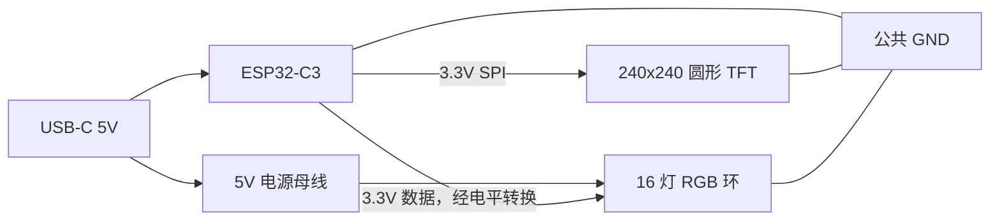

# AGENTMATE 硬件连接说明

本文档描述 AGENTMATE V1 原型的推荐接线方式：ESP32-C3、16 颗 RGB LED 灯环和 240×240 圆形 SPI TFT 屏幕。默认屏幕驱动为 GC9A01。

> 本文档使用的是一套推荐 GPIO 分配，不代表所有 ESP32-C3 开发板的固定引脚。正式焊接前，请以所用开发板的原理图和丝印为准，并确认该板没有把推荐 GPIO 接到板载外设。

## 1. 系统连接关系



设计原则：

1. USB-C 同时提供供电和 USB CDC 通信。
2. LED 灯环使用 USB 的 5V；ESP32-C3 和 TFT 使用 3.3V。
3. TFT 与 LED 共用地线。
4. 复杂的 Agent 逻辑放在电脑端，ESP32-C3 只负责通信、显示和灯效。

## 2. 推荐引脚分配

| 功能 | ESP32-C3 GPIO | 模块引脚 | 说明 |
|---|---:|---|---|
| RGB 数据 | GPIO1 | LED DIN | WS2812B/SK6812 单线输入 |
| TFT 时钟 | GPIO6 | TFT SCL/SCLK | SPI 时钟 |
| TFT 数据 | GPIO7 | TFT SDA/MOSI | SPI 主出从入 |
| TFT 片选 | GPIO10 | TFT CS | 低电平有效 |
| TFT 命令/数据 | GPIO3 | TFT DC/A0 | 高电平为数据，低电平为命令 |
| TFT 复位 | GPIO4 | TFT RES/RST | 可选由硬件上拉；建议保留软件控制 |
| TFT 背光 | GPIO5 | TFT BL/LED | 建议通过三极管或 MOSFET 控制 |
| 电源 | 3V3 | TFT VCC | 只连接支持 3.3V 的屏幕模块 |
| 电源 | USB 5V | LED 5V/VCC | 不要把 5V 接到 ESP32-C3 的 3V3 引脚 |
| 地 | GND | TFT GND、LED GND | 必须共地 |

GPIO18/19 建议保留给 ESP32-C3 原生 USB。GPIO2、GPIO8、GPIO9 等启动相关引脚也不建议用于带强上拉/下拉的外设。

## 3. RGB 灯环接线

### 3.1 基本接线

```text
USB 5V  ───────────── LED 5V/VCC
USB GND ─────┬─────── LED GND
             └─────── ESP32-C3 GND
GPIO1 ──330~470Ω──── LED DIN
```

如果灯环标有 `DOUT` 和 `DIN`，数据线必须接 `DIN`。多个灯环串联时，前一个灯环的 `DOUT` 才接下一个灯环的 `DIN`。

### 3.2 必须增加的保护元件

- 在灯环 5V 和 GND 之间靠近灯环的位置并联 470~1000 µF 电解电容，电压等级不低于 10 V。
- 在 GPIO1 到 LED DIN 之间串联 330~470 Ω 电阻，电阻尽量靠近灯环 DIN。
- ESP32-C3 的 3.3V 数据电平在部分 5V 灯珠上可能不能稳定识别。推荐使用 `74AHCT1G125`、`74HCT125` 或同类 3.3V 输入/5V 输出的电平转换器。
- 电平转换器的输入侧接 ESP32-C3 的 3.3V，输出侧接 LED 的 5V，电平转换器和灯环共地。

### 3.3 电流预算

16 颗灯珠在全白、100% 亮度时，峰值电流可能接近 16 × 60 mA = 960 mA；不同灯珠型号会有差异。原型阶段建议软件限制在 20%~40% 亮度，并避免让屏幕和灯环同时超过 USB 端口的供电能力。若使用普通 USB 口，建议整机按至少 1.5 A 的 5V 供电能力设计。

## 4. TFT 屏幕接线

以常见的 GC9A01 SPI 模块为例：

```text
ESP32-C3 GPIO6  ───── TFT SCL/SCLK
ESP32-C3 GPIO7  ───── TFT SDA/MOSI
ESP32-C3 GPIO10 ───── TFT CS
ESP32-C3 GPIO3  ───── TFT DC/A0
ESP32-C3 GPIO4  ───── TFT RES/RST
ESP32-C3 GPIO5  ───── TFT BL/LED（可选）
ESP32-C3 3V3    ───── TFT VCC
ESP32-C3 GND    ───── TFT GND
```

注意事项：

1. 这类屏幕通常只需要 `SCLK`、`MOSI`、`CS`、`DC`、`RST`，不需要 MISO；若模块有 MISO，可悬空或接到未使用 GPIO，V1 不读取屏幕数据。
2. `TFT BL/LED` 若直接接 3.3V 会常亮；需要调节亮度时，用 GPIO5 驱动三极管/MOSFET 控制背光，不要让 GPIO 直接承受背光电流。
3. 不同模块的 `VCC` 可能标称 3.3V 或 5V。优先选择明确支持 3.3V 逻辑和 3.3V 供电的模块；不要仅凭接口名称判断是否 5V 容忍。
4. TFT 的 SPI 线可以使用短线，屏幕排线和 LED 数据线应尽量远离 USB 5V 的大电流回路。

## 5. 电源与地线

推荐的电源拓扑如下：

```text
USB-C 5V
  ├── ESP32-C3 开发板 VIN/5V（由板载稳压器产生 3.3V）
  └── RGB 灯环 5V

ESP32-C3 3V3 ── TFT VCC
USB GND ─────── ESP32-C3 GND ── TFT GND ── LED GND
```

如果使用裸芯片或自制主板，需要单独设计 5V 输入保护、3.3V 稳压、USB ESD 保护和反接保护。使用开发板验证时，不要同时从多个 USB/外部 3.3V 电源给板子供电。

## 6. 推荐物料

| 数量 | 物料 | 推荐规格 |
|---:|---|---|
| 1 | 主控开发板 | ESP32-C3，带原生 USB 或 USB-UART |
| 1 | 圆形 TFT | 240×240，GC9A01，3.3V 逻辑 |
| 1 | RGB 灯环 | 16 灯，WS2812B 或 SK6812 |
| 1 | 电平转换器 | 74AHCT1G125 / 74HCT125 |
| 1 | 电解电容 | 470~1000 µF，≥10 V |
| 1 | 串联电阻 | 330~470 Ω |
| 1 | 背光驱动 | 小信号 N-MOSFET 或 NPN 三极管（可选） |

## 7. 上电与调试顺序

1. 只连接 ESP32-C3，确认 USB 枚举和固件下载正常。
2. 连接 TFT，先运行纯色填充和文字显示测试，确认 SPI 引脚、驱动型号和屏幕方向。
3. 断电后连接灯环，先将亮度限制为 5%~10%，只点亮第一颗灯珠。
4. 检查灯环 5V 电压、ESP32-C3 3.3V 电压和公共地线，再逐步增加灯珠数量与亮度。
5. 最后接入 AGENTMATE Desktop，验证 USB CDC、JSON Lines 状态切换、屏幕刷新和灯效同步。

## 8. 常见故障

| 现象 | 优先检查 |
|---|---|
| 灯环完全不亮 | 5V/GND 极性、DIN 方向、公共地线、灯环数据电平 |
| 只有第一颗灯珠异常 | DIN 电阻、首颗灯珠损坏、数据线过长 |
| 灯环随机闪烁或 ESP32 重启 | USB 供电不足、没有大电容、地线过细或接触不良 |
| 屏幕白屏 | VCC 电压、RST/DC/CS 接线、SPI 驱动型号 |
| 屏幕有背光但无图像 | SPI 时钟/数据线、屏幕初始化参数、CS 和 DC |
| 电脑无法识别设备 | USB 数据线、GPIO18/19 是否被外设占用、USB CDC 配置 |

## 9. 原型阶段结论

第一版建议先采用“开发板 + 插接线”验证，不要立即做一体化 PCB。等屏幕具体型号、灯环供电电流和外壳尺寸确定后，再将 GPIO 分配、电源铜线宽度、LED 电源注入点和安装孔位固化到 PCB 设计中。
